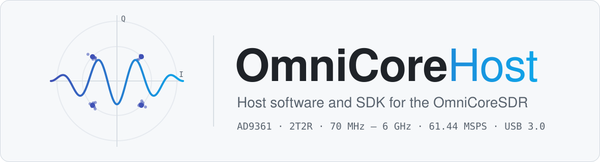
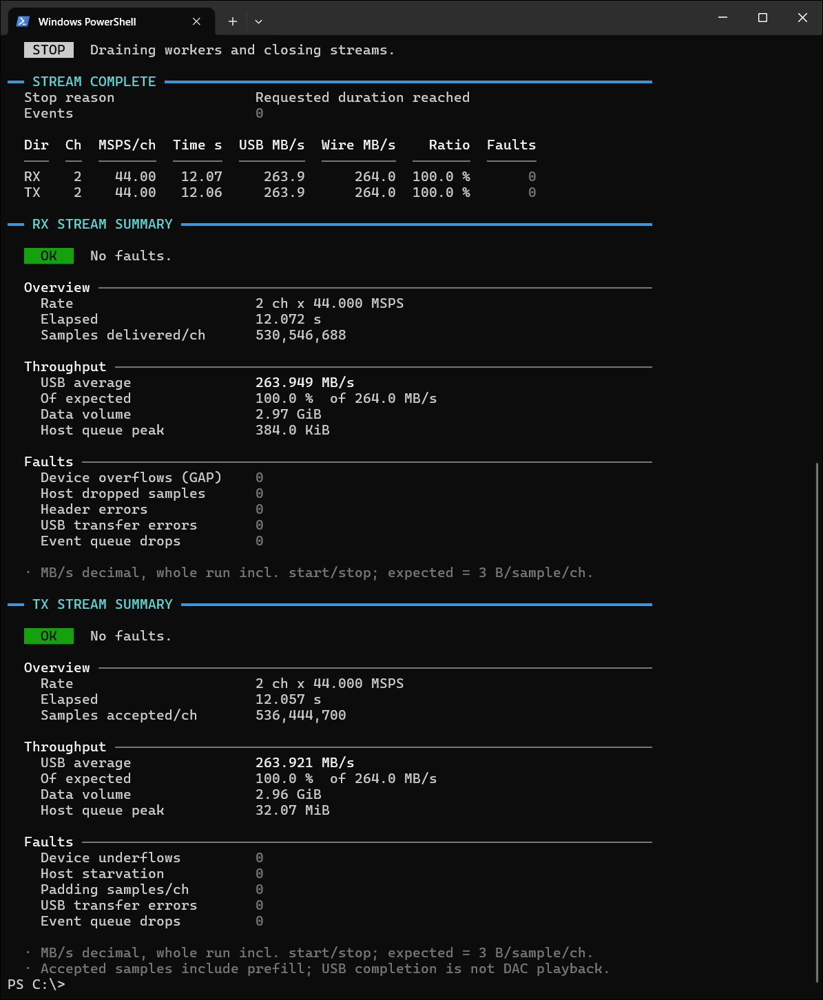
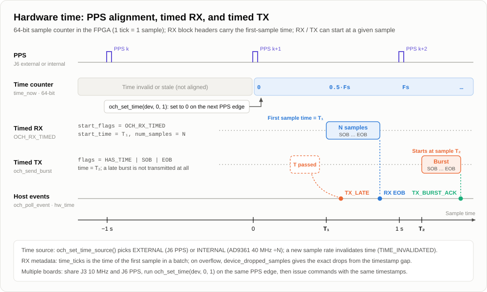
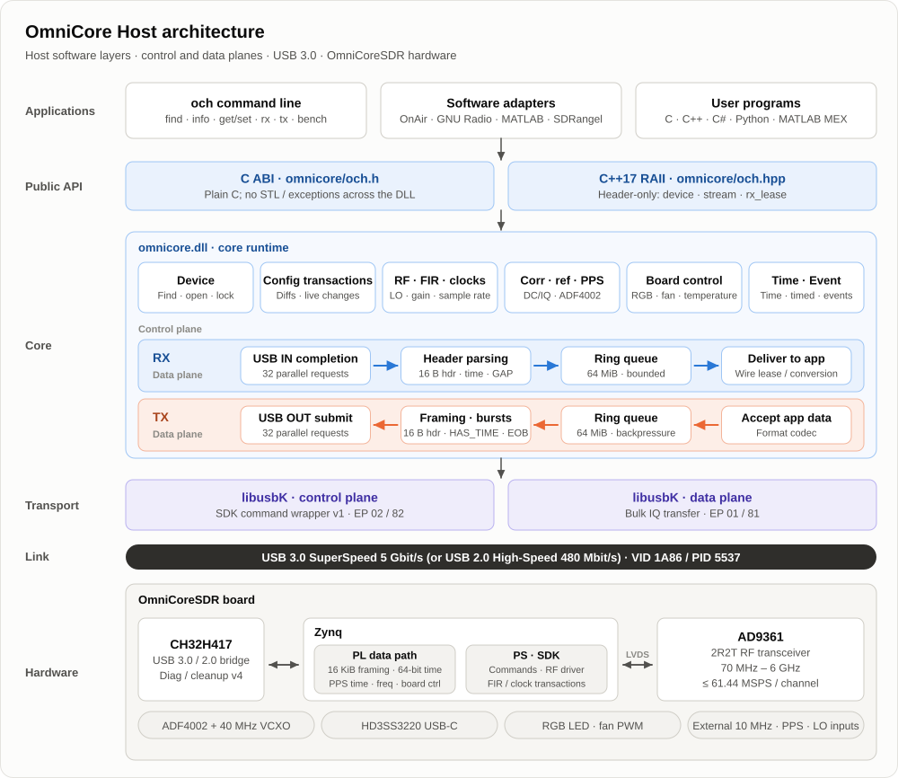

<div align="center">

<picture>
  <source media="(prefers-color-scheme: dark)" srcset="docs/images/banner-dark.svg">
  
</picture>

[](https://github.com/Liren66/OmniCore-SDR-Host/actions/workflows/ci.yml)
[](https://liren66.github.io/OmniCore-SDR-Host/)
[](https://github.com/Liren66/OmniCore-SDR-Host/releases)
[](LICENSE)
[](#quick-start)

**[Documentation](https://liren66.github.io/OmniCore-SDR-Host/)** · **[Releases](https://github.com/Liren66/OmniCore-SDR-Host/releases)** · **[Changelog](CHANGELOG.md)** · **[简体中文](README.zh-CN.md)**

</div>

OmniCore Host (OCH) is the host-side software for **OmniCoreSDR** (AD9361 + Zynq + CH32H417 USB bridge): a C++17 runtime library, the `och` command-line tool, a public C/C++ SDK, a SoapySDR plugin, and a MATLAB toolbox. It handles device discovery, RF control, continuous IQ receive and transmit, hardware timestamps, and throughput testing. [OmniCore-SDR-OnAir](https://github.com/Liren66/OmniCore-SDR-OnAir) (a fork of OnAir) uses it to support RX, TX, and full duplex natively.

<p align="center"></p>

> [!IMPORTANT]
> Needs Zynq firmware **[v2026.11.07](https://github.com/Liren66/OmniCore-SDR-Firmware/releases/tag/v2026.11.07) or later** (framed USB transport); **[v2026.11.08](https://github.com/Liren66/OmniCore-SDR-Firmware/releases/tag/v2026.11.08)** is recommended. Multi-board sync needs v2026.11.07.2+, and live USB-C current readings need bridge firmware 1.0.1. See [Firmware Compatibility](docs/firmware-compatibility.md).

## Highlights

- **Full-rate streaming** — 2T2R at up to 61.44 MSPS over USB 3.0 (8-bit), 44 MSPS at 12-bit; USB 2.0 High-Speed for lower rates. [Benchmarks](docs/benchmarks.md)
- **Exact data boundaries** — every 16 KiB block carries a header and a 64-bit sample time, so dropped samples are counted exactly and gaps are marked with epochs.
- **Hardware time** — PPS alignment, timed RX, timed TX bursts, and events stamped with sample time. [Timestamps](docs/timestamps.md)
- **Multi-board sync** — daisy-chained or common 10 MHz + PPS, with lock checks and AD9361 multi-chip sync. [Multi-Board Sync](docs/multi-board-sync.md)
- **Runtime reconfiguration** — change frequency, gain, sample rate, or FIR without destroying streams; a same-band retune takes about 4 ms. [API](docs/api.md#changing-parameters-at-runtime)
- **Clocking** — external 10 MHz reference, independent external RX/TX LO, PPS-disciplined 40 MHz oscillator. [Reference and LO](docs/reference-lo.md) · [PPS](docs/pps.md)
- **Works with your tools** — `och` CLI, C ABI + C++ wrapper, SoapySDR (GNU Radio, SDR++, SDRangel, Python), MATLAB and Simulink.
- **Bridge firmware updates over USB** with `och firmware update`. [Firmware Update](docs/firmware-update.md)

## Quick Start

### 1. Install

Download a package from [Releases](https://github.com/Liren66/OmniCore-SDR-Host/releases) for your platform.

<details>
<summary><b>Windows 10/11 x64</b></summary>

Run `OmniCoreHost-0.8.0-win64-setup.exe`. It installs to `C:\Program Files\OmniCore Host` and adds itself to PATH, with `och.exe`, the runtime libraries, headers, MinGW/MSVC import libraries, the CMake package config, examples, documentation, and a driver helper:

```powershell
och-driver check      # check only, does not modify the system
och-driver install    # install libusbK for VID 1A86 / PID 5537 (needs UAC)
```

See [Windows Installation](packaging/windows/INSTALL_WINDOWS.txt) for driver details and logs.

</details>

<details>
<summary><b>Linux x86_64</b></summary>

```bash
tar -xzf OmniCoreHost-0.8.0-linux-x86_64.tar.gz
sudo mkdir -p /opt/omnicore && sudo mv OmniCoreHost-linux /opt/omnicore/0.8.0
sudo ln -sfn /opt/omnicore/0.8.0/bin/och /usr/local/bin/och
sudo install -m 0644 /opt/omnicore/0.8.0/share/omnicore/60-omnicore.rules /etc/udev/rules.d/
sudo udevadm control --reload-rules
```

Needs the system `libusb-1.0-0`. See [Installing on Linux and macOS](docs/install.md) for USB permissions and building from source.

</details>

<details>
<summary><b>macOS 12+ (universal)</b></summary>

No driver or Homebrew needed (libusb is statically linked):

```bash
tar -xzf OmniCoreHost-0.8.0-macos-universal.tar.gz
xattr -dr com.apple.quarantine OmniCoreHost-macos   # Gatekeeper quarantines browser downloads
sudo mkdir -p /opt/omnicore && sudo mv OmniCoreHost-macos /opt/omnicore/0.8.0
sudo ln -sfn /opt/omnicore/0.8.0/bin/och /usr/local/bin/och
```

</details>

### 2. Connect a device

```powershell
och version        # software version and ABI
och find           # enumerate devices
och info           # identity, firmware versions, USB link, RF capabilities, time base, power
och selftest       # digital interface self-test (RX PRBS / TX loopback)
```

### 3. Receive and transmit IQ

```powershell
# Receive on two channels for 5 s: LO 1 GHz, 15.36 MSPS per channel, saved as sc16
och rx --file rx.sc16 --format sc16 --channels 1,2 --lo-frequency 1G --sample-rate 15.36M --seconds 5

# Play the file back in a loop for 5 s with 60 dB TX attenuation
och tx --file rx.sc16 --format sc16 --channels 1,2 --lo-frequency 1G --sample-rate 15.36M --loop --seconds 5 --attenuation 60

# Transmit a 1 MHz baseband test tone
och tx --tone 1M --amplitude 0.25 --channels 1 --lo-frequency 1G --sample-rate 15.36M --seconds 5 --attenuation 60

# Full-duplex throughput test (no file I/O)
och bench --rx --tx --channels 1,2 --sample-rate 30.72M --seconds 10
```

> [!NOTE]
> Transmit commands produce RF output. Connect a load or an attenuated test loop. `Ctrl+C` stops at any time; existing capture files are not overwritten unless you pass `--overwrite`.

## Command Line

| Area | Commands |
|---|---|
| Device | `find` · `info` · `power` · `version` · `selftest` |
| Control | `commands` · `get NAME` · `set NAME VALUE` · `action NAME` · `config [RF options]` |
| FIR / clocks | `fir status` · `fir rx\|tx load FILE` · `fir rx\|tx\|both on\|off` · `clock status` · `clock sample-rate HZ` |
| Streaming | `rx --file PATH` · `tx --tone HZ` · `tx --file PATH [--loop]` · `bench --rx [--tx]` |
| Multi-board sync | `sync --devices M,S1,...` · `sync --mode common` · `sync status` · `sync off` |
| Bridge firmware | `firmware [info]` · `firmware check FILE` · `firmware update FILE` · `firmware boot` · `firmware enter` |

Global options: `--serial` selects a device, `--json` prints machine-readable output, `--no-color` turns off color. Numbers accept `k`/`M`/`G` suffixes; canonical commands always use Hz and dB. See the [CLI Reference](docs/cli.md) and [Command Catalog](docs/commands.md).

<table>
<tr>
<td width="50%" valign="top"></td>
<td width="50%" valign="top"></td>
</tr>
<tr>
<td align="center"><sub>Running: session, RF configuration, and live progress</sub></td>
<td align="center"><sub>Finished: throughput summary and grouped statistics</sub></td>
</tr>
</table>

<details>
<summary><b>Common control examples</b></summary>

```powershell
och set rx.lo-frequency 2.4G
och set tx1.attenuation 10
och config --sample-rate 30.72M --lo-frequency 1G --bandwidth 18M --gain 30

och set rx.dc-correction on          # RX DC tracking
och set clock.ref-source external    # external 10 MHz reference (J3)
och set rx.lo-source external        # external LO (RX: J11, TX: J10; input is 2x the RF frequency)
och set pps.input-enabled on         # PPS input (J6); disciplines the oscillator when there is no 10 MHz
och get clock.vcxo-status            # tuning mode and CH32 loop state

och fir rx load filter.ftr && och fir rx on
och rssi on && och rssi --count 0 --interval 0.2   # RX1/RX2 RSSI (relative dB)
och firmware update OmniCore-Bridge-1.0.1.ocfw      # bridge firmware over USB, about 5 s
```

</details>

<details>
<summary><b>IQ file formats and exit codes</b></summary>

| Format | Per sample per channel | Notes |
|---|---:|---|
| `packed12` | 3 bytes | Native USB 12-bit |
| `sc16` | 4 bytes | int16 I/Q, little-endian; default for `rx`/`tx` |
| `fc32` | 8 bytes | float32 I/Q, normalized to ±1 |
| `sc8` | 2 bytes | int8 I/Q; requires `--iq-bits 8` |

Two channels are interleaved as `I1,Q1,I2,Q2`; files have no container header. A capture also writes `.metadata.jsonl` with the configuration, each epoch's file position and hardware time (`time_ticks`), and exact drop counts. **Data before and after an overflow must not be joined as if it were continuous**, but `time_ticks` places it back on one timeline.

Exit codes: `0` completed · `1` device/transport error · `2` invalid arguments · `3` `bench --fail-fast` stopped early · `130` Ctrl+C. Judge performance by `stability.pass` in the JSON, not the exit code alone.

</details>

## Benchmarks

Highest sample rate with zero errors in `och bench` (OCH 0.6.1, Windows 11, USB 3.0; top settings confirmed with 300-second runs):

| Configuration | Sample rate / channel | RX / TX MB/s |
|---|---:|---:|
| 1 RX or 2 RX | 61.44 MSPS | 184.1 / — or 368.5 / — |
| 1 RX + 1 TX | 61.44 MSPS | 183.9 / 183.8 |
| 1 RX + 2 TX | 58 MSPS | 174.2 / 348.3 |
| 2 RX + 1 TX | 58.5 MSPS | 351.3 / 175.7 |
| 2 RX + 2 TX · 12-bit | 44 MSPS | 264.2 / 264.2 |
| 2 RX + 2 TX · 8-bit | 61.44 MSPS | 245.2 / 245.1 |

The limit is the roughly 533 MB/s UHSIF bus between the FPGA and the CH32, shared by RX and TX. USB 2.0 High-Speed is stable at 14 MSPS single-channel, 3.5 MSPS for 2T2R 12-bit, and 5 MSPS for 2T2R 8-bit. Results depend on the host controller, port, and cable; see [Benchmarks](docs/benchmarks.md).

## C/C++ Development

`include/omnicore/och.h` is a plain C ABI (no STL or exceptions across the DLL, callable from MSVC, MinGW, C#, Python, MATLAB MEX); `include/omnicore/och.hpp` is a header-only C++17 RAII wrapper.

```cmake
find_package(OmniCoreHost 0.8 CONFIG REQUIRED)
target_link_libraries(myapp PRIVATE OmniCore::omnicore)
```

```cpp
#include <omnicore/och.hpp>

och::device dev;                         // the only device; pass a serial number when there are several
auto cfg = och::default_config();
cfg.sample_rate = 30720000;
cfg.rx_mask = 3;                         // RX1 + RX2
dev.configure(cfg);

och::stream rx(dev, och::stream_args(OCH_RX));
rx.start();
// read with rx.recv(...) or zero-copy via och::rx_lease; epoch / flags in the metadata mark discontinuities
```

<details>
<summary><b>Hardware time: PPS alignment, timed RX, and timed TX</b></summary>



```c
och_set_time_source(dev, OCH_TIME_SOURCE_INTERNAL);     // or EXTERNAL (J6 PPS)
och_set_time(dev, 0, 1);                                // set time to 0 on the next PPS edge

och_stream_args a; och_default_stream_args(&a, OCH_RX); // timed RX: receive N samples starting at t = T
a.start_flags = OCH_RX_TIMED; a.num_samples = N;
a.start_time_lo = (uint32_t)T; a.start_time_hi = (uint32_t)(T >> 32);

och_tx_metadata md = {sizeof md, OCH_TX_HAS_TIME | OCH_TX_START_OF_BURST | OCH_TX_END_OF_BURST, T2};
och_send_burst(tx, samples, n, &md, &accepted, 1000);   // transmit at sample time T2
```

</details>

<details>
<summary><b>Architecture</b></summary>



</details>

Examples: [receive](examples/receive.cpp) · [transmit](examples/transmit.cpp) · [runtime reconfiguration](examples/reconfigure.cpp) · [8-bit full duplex](examples/duplex_iq8.cpp) · [sweep waterfall and live demo](docs/sweep.md). See the [API Reference](docs/api.md), [Architecture](docs/architecture.md), and [Building from Source](docs/development.md).

## GNU Radio and SoapySDR

`bindings/soapy/` is a [SoapySDR](https://github.com/pothosware/SoapySDR) plugin with driver name `omnicore`, so GNU Radio (gr-soapy), SDR++, SDRangel, and the SoapySDR Python / C++ APIs can use the board directly. It must be built against the SoapySDR on your machine, so it ships as source:

```bash
cmake -S . -B build -DOCH_BUILD_SOAPY=ON && cmake --build build -j
sudo cmake --install build --prefix /usr/local     # macOS (Homebrew): --prefix "$(brew --prefix)"
SoapySDRUtil --find="driver=omnicore"
```

For full duplex in GNU Radio, give the source and sink the same `rx_mask` and `tx_mask`. Verified on macOS; built in CI on Linux and Windows. See [SoapySDR Plugin](docs/soapy.md).

## MATLAB

`bindings/matlab/` is a toolbox for MATLAB R2018a+ that needs no other toolboxes: `omnicore.Device`, `RxStream` / `TxStream`, and the `Receiver` / `Transmitter` System objects for Simulink. Download `omnicore-matlab-<version>-<platform>.zip` from the releases page and add it to the path:

```matlab
addpath('<extract-dir>/omnicore-matlab');
dev = omnicore.Device('SampleRate', 30.72e6, 'RxFrequency', 2.45e9);
[x, meta] = receive(dev, 1e6);          % 1e6 x 2 complex single; meta holds hardware time and drop positions
delete(dev)
```

It ships with MATLAB help pages (`omnicore.doc`) and runnable examples — FM radio, FM loopback, a QPSK video link, and a scope — that also run without a device using `'Simulate', true`. See [MATLAB Toolbox](docs/matlab.md).

## Documentation

The full documentation is at **<https://liren66.github.io/OmniCore-SDR-Host/>** (also in [`docs/`](docs/) and, in Chinese, [`docs/zh-CN/`](docs/zh-CN/)).

| Getting started | Features | Integrations | Reference |
|---|---|---|---|
| [Installation](docs/install.md) | [Hardware Timestamps](docs/timestamps.md) | [C/C++ API](docs/api.md) | [Command Catalog](docs/commands.md) |
| [CLI Reference](docs/cli.md) | [Multi-Board Sync](docs/multi-board-sync.md) | [SoapySDR Plugin](docs/soapy.md) | [Device Protocol](docs/protocol.md) |
| [Troubleshooting](docs/troubleshooting.md) | [Sweep Waterfall](docs/sweep.md) | [MATLAB Toolbox](docs/matlab.md) | [Architecture](docs/architecture.md) |
| [Bridge Firmware Update](docs/firmware-update.md) | [8-bit USB IQ](docs/iq8.md) · [FIR and Clocks](docs/fir.md) | [Windows Installation](packaging/windows/INSTALL_WINDOWS.txt) | [Benchmarks](docs/benchmarks.md) |
| [Firmware Compatibility](docs/firmware-compatibility.md) | [Reference and LO](docs/reference-lo.md) · [PPS](docs/pps.md) | [Building from Source](docs/development.md) | [Board Control](docs/board-control.md) · [Changelog](CHANGELOG.md) |

## License

Copyright (C) 2026 OmniCoreSDR contributors. Licensed under the [GNU General Public License v3.0 or later](LICENSE) (`SPDX-License-Identifier: GPL-3.0-or-later`); contributions are accepted under the same license. This program is provided "as is", without any warranty. Third-party components such as libusbK and libwdi keep their own licenses; see `third_party/driver/NOTICES.txt`.
