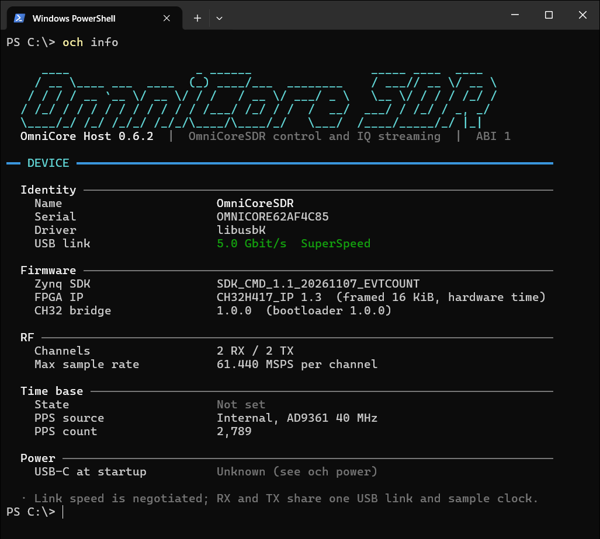
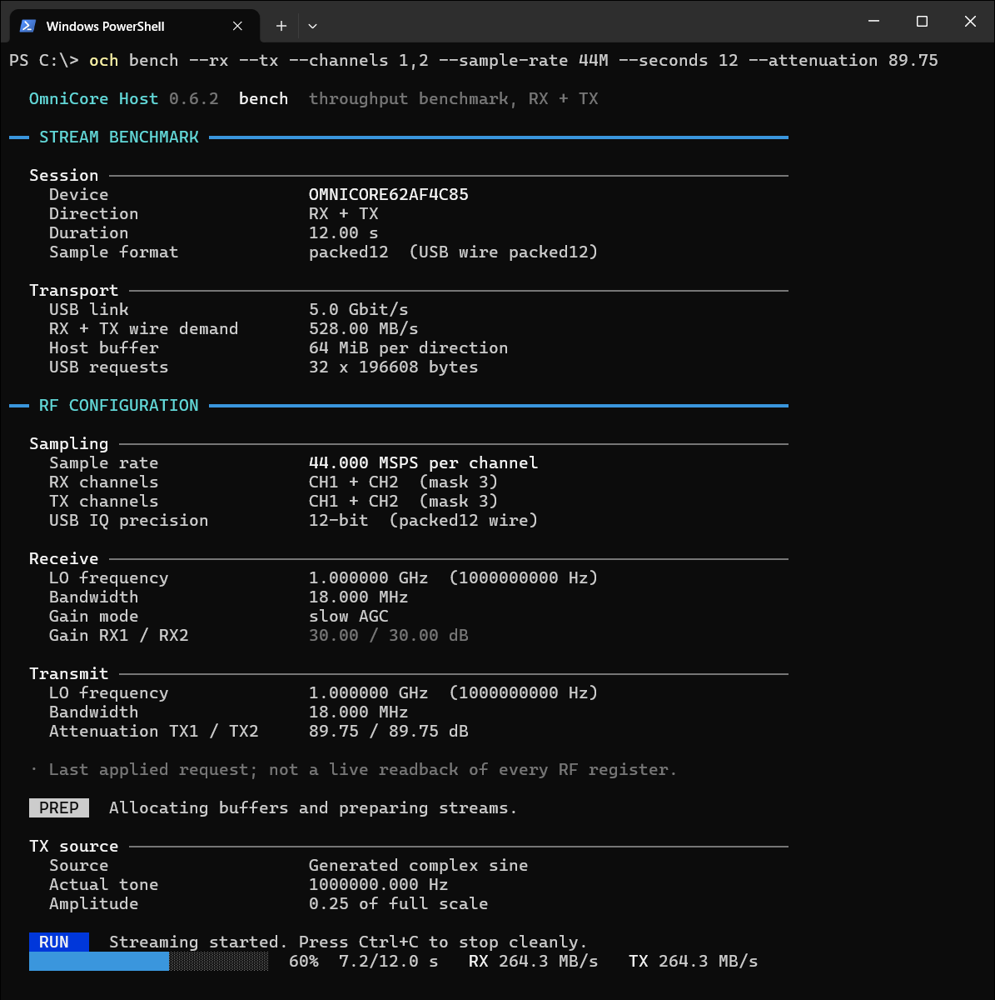
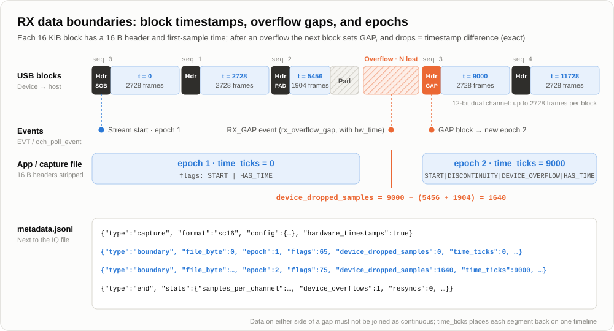

# OmniCore Host (OCH)

English | [简体中文](README.zh-CN.md) · **Documentation: <https://liren66.github.io/OmniCore-SDR-Host/>**

OmniCore Host is the host-side software for **OmniCoreSDR** (AD9361 + Zynq + CH32H417 USB bridge): a C++17 runtime library, the `och` command-line tool, and a public C/C++ SDK. It handles device discovery, RF control, continuous IQ receive and transmit, RX data-boundary recovery, and throughput testing, and serves as the foundation for higher-level software such as GNU Radio, MATLAB, and SDRangel. [OmniCore-SDR-OnAir](https://github.com/Liren66/OmniCore-SDR-OnAir) (a fork of OnAir) uses it to support RX, TX, and full duplex natively.

| Version | Platforms | Interface | License |
|---|---|---|---|
| **0.8.0** (C ABI 1) | Windows 10/11 x64 (libusbK)<br>Linux x86_64 (libusb 1.0)<br>macOS 12+ universal binary (libusb 1.0; not tested on Intel Macs) | Plain C ABI + header-only C++ RAII wrapper | GPL-3.0-or-later |


> [!IMPORTANT]
> **Recommended firmware: [v2026.11.08](https://github.com/Liren66/OmniCore-SDR-Firmware/releases/tag/v2026.11.08) — Zynq `SDK_CMD_1.2_20261107_SYNC`, FPGA `CH32H417_IP` 1.3, CH32 bridge 1.0.1.**
>
> - Minimum Zynq firmware is [v2026.11.07](https://github.com/Liren66/OmniCore-SDR-Firmware/releases/tag/v2026.11.07) (framed USB transport: every 16 KiB block carries a 16-byte header and a 64-bit sample time). Older firmware only works with OCH 0.5.x; the two cannot be mixed.
> - Multi-board sync (`och sync`) requires Zynq firmware v2026.11.07.2 or later (`SDK_CMD_1.2`).
> - Reading the USB-C current on every `och info` / `och power` call requires bridge firmware 1.0.1 (`och firmware update OmniCore-Bridge-1.0.1.ocfw`); with 1.0.0 it can only be read the first time after power-up.
>
> See [Firmware Compatibility](docs/firmware-compatibility.md) for how versions map to each other.

## Contents

1. [Features](#features)
2. [Quick Start](#quick-start)
3. [Command Line](#command-line)
4. [Benchmarks](#benchmarks)
5. [C/C++ Development](#cc-development) (including [Hardware Time](#hardware-time))
6. [GNU Radio and SoapySDR](#gnu-radio-and-soapysdr)
7. [MATLAB](#matlab)
8. [Building and Packaging from Source](#building-and-packaging-from-source)
9. [Project Layout](#project-layout)
10. [Documentation Index](#documentation-index)

## Features

| Area | Details |
|---|---|
| Multi-board sync | `och sync`: without an external reference, boards daisy-chain a shared 10 MHz (REF_OUT → 10M_EXT) and the master's TRIG synchronizes them; or all boards share a common 10 MHz + PPS (atomic clock, GPSDO). Includes lock checks, AD9361 multi-chip sync, and loading a common time. Requires firmware SDK_CMD_1.2. See [Multi-Board Sync](docs/multi-board-sync.md) |
| Hardware timestamps | 64-bit sample time (1 tick = 1 sample), time alignment to external / internal PPS, timed RX, timed TX bursts, events stamped with sample time. See [Hardware Timestamps](docs/timestamps.md) |
| Device and RF | Device discovery and status; RX/TX LO, gain, attenuation, bandwidth, channel configuration |
| IQ streaming | Single/dual-channel RX, TX, and full duplex; file capture and playback, test tones, throughput statistics |
| Data integrity | Every 16 KiB block carries a 16-byte header (sequence number, valid frame count, sample time, checksum); the number of samples lost to an overflow is derived exactly from the timestamp gap, and discontinuities are marked with an epoch and metadata |
| USB IQ format | 12-bit packed by default; 2TX2RX can optionally use 8-bit signed to reduce bandwidth |
| Bridge firmware update | `och firmware update` updates the CH32H417 bridge firmware over USB and can be rerun after an interruption (requires bridge firmware 1.0.0+) |
| FIR and clocks | Load and enable/disable the AD9361 hardware FIR; configure the sample rate and the six-stage clock chain |
| Nearest sample rate | Rates the BBPLL fractional divider cannot hit exactly are replaced by the nearest whole-Hz rate with a notice, e.g. 11.2 MSPS → 11200011 Hz |
| Runtime reconfiguration | Without destroying stream handles: coordinated pause → apply configuration → resume |
| Correction and reference | RX DC / IQ tracking; ADF4002 internal/external 10 MHz reference; independent external LO for RX and TX |
| PPS disciplining | With PPS only, the CH32 PA4 DAC disciplines the 40 MHz oscillator (phase lock within ±1 µs); together with 10 MHz, PPS is only used to check the frequency offset |
| Monitoring and board control | PPS frequency-offset monitoring (±1 ppm LOCK), RGB status LED, temperature-controlled fan |
| USB link | USB 3.0 SuperSpeed; USB 2.0 High-Speed works for low sample rates |
| SoapySDR plugin | `driver=omnicore`, for GNU Radio (gr-soapy), SDR++, SDRangel, Python, and more. See [SoapySDR Plugin](docs/soapy.md) |
| MATLAB toolbox | Capture, transmit, timed RX/TX, and full duplex directly from MATLAB R2018a+, with System objects and Simulink; no other toolboxes required. See [MATLAB Toolbox](docs/matlab.md) |

## Quick Start

### 1. Install

**Windows**: run `OmniCoreHost-0.8.0-win64-setup.exe` (from [Releases](https://github.com/Liren66/OmniCore-SDR-Host/releases)). It installs to `C:\Program Files\OmniCore Host` by default and adds itself to PATH. The installer includes `och.exe`, the runtime libraries, headers, MinGW/MSVC import libraries, the CMake package config, examples and documentation, plus a driver helper:

```powershell
och-driver check      # check only, does not modify the system
och-driver install    # install libusbK for VID 1A86 / PID 5537 (needs UAC)
```

**Linux**:

```bash
sudo apt-get install build-essential cmake ninja-build pkg-config libusb-1.0-0-dev
bash tools/build-linux.sh
sudo cmake --install build/linux --prefix /opt/omnicore/0.8.0
sudo ln -sfn /opt/omnicore/0.8.0/bin/och /usr/local/bin/och
sudo install -m 0644 packaging/linux/60-omnicore.rules /etc/udev/rules.d/
sudo udevadm control --reload-rules
```

**macOS**: extract `OmniCoreHost-0.8.0-macos-universal.tar.gz` (arm64 + x86_64 universal binary, libusb statically linked, no Homebrew needed). No driver is required:

```bash
tar -xzf OmniCoreHost-0.8.0-macos-universal.tar.gz
xattr -dr com.apple.quarantine OmniCoreHost-macos   # Gatekeeper quarantines archives downloaded by a browser
sudo mkdir -p /opt/omnicore && sudo mv OmniCoreHost-macos /opt/omnicore/0.8.0
sudo ln -sfn /opt/omnicore/0.8.0/bin/och /usr/local/bin/och
```

Running it does not need sudo. For USB permissions, directory layout, building from source, and performance settings, see [Installing on Linux and macOS](docs/install.md); for Windows, see [Windows Installation](packaging/windows/INSTALL_WINDOWS.txt).

### 2. Connect a device

```powershell
och version        # software version and ABI
och find           # enumerate devices
och info           # identity, firmware versions, USB link, RF capabilities, time base, power
och selftest       # digital interface self-test (RX PRBS / TX loopback)
```

<p align="center"></p>
<p align="center"><sub>Real screenshot: OCH 0.7.1, USB 3.0 SuperSpeed, Zynq <code>SDK_CMD_1.2_20261107_SYNC</code>, CH32 bridge 1.0.1, USB-C 3000 mA</sub></p>

### 3. Receive and transmit IQ

```powershell
# Receive on two channels for 5 s: LO 1 GHz, 15.36 MSPS per channel, saved as sc16
och rx --file rx.sc16 --format sc16 --channels 1,2 --lo-frequency 1G --sample-rate 15.36M --seconds 5

# Play the file back in a loop for 5 s with 60 dB TX attenuation
och tx --file rx.sc16 --format sc16 --channels 1,2 --lo-frequency 1G --sample-rate 15.36M --loop --seconds 5 --attenuation 60

# Transmit a 1 MHz baseband test tone
och tx --tone 1M --amplitude 0.25 --channels 1 --lo-frequency 1G --sample-rate 15.36M --seconds 5 --attenuation 60

# Full-duplex throughput test (no file I/O)
och bench --rx --tx --channels 1,2 --sample-rate 30.72M --seconds 10
```

> [!NOTE]
> Transmit commands produce RF output. Connect a load or an attenuated test loop. `Ctrl+C` stops at any time; existing capture files are not overwritten unless you pass `--overwrite`.

### Device firmware requirements

The installer only contains host software and does not flash board firmware. You need `BOOT.bin` from [OmniCore-SDR-Firmware](https://github.com/Liren66/OmniCore-SDR-Firmware/releases) v2026.11.07 or later (FPGA `CH32H417_IP` 1.3, `SDK_CMD_1.1` or later); v2026.11.08 (`SDK_CMD_1.2`, bridge 1.0.1) is recommended. OCH checks for `transport=framed16k` when opening a device and refuses to connect otherwise. The CH32 bridge firmware can be updated manually over USB with `och firmware update FILE.ocfw`; see [Bridge Firmware Update](docs/firmware-update.md). The device also needs SDK command wrapper v1 and CH32 diagnostic protocol v4. Optional features are enabled according to the capability fields returned by `och get system.info` (e.g. `rx_correction=1`, `external_lo=1`, `pps_monitor=1`); when one is missing, only that feature is refused. TX FIR interpolation ×2 / ×4 needs SDK firmware that includes the TX coefficient read-back fix; older firmware can only use interpolation 1. See [Firmware Compatibility](docs/firmware-compatibility.md) for details.

## Command Line

### Updating the bridge firmware

CH32 bridge firmware 1.0.0 and later can be updated directly over USB. Download the update package from [OmniCore-SDR-Firmware Releases](https://github.com/Liren66/OmniCore-SDR-Firmware/releases):

```bash
och firmware info                                  # current version and mode
och firmware update OmniCore-Bridge-1.0.1.ocfw     # about 5 s; can be rerun after an interruption
```

If `och firmware info` shows `legacy` or `Bootloader: none`, you first need to flash `Merge.bin` once with a WCH-Link.
For the full procedure see [Firmware README: Updating the CH32 bridge firmware](https://github.com/Liren66/OmniCore-SDR-Firmware#升级-ch32-桥接固件); for commands and recovery see [Bridge Firmware Update](docs/firmware-update.md).

### Command overview

| Area | Commands |
|---|---|
| Device | `find` · `info` · `power` · `version` · `selftest` |
| Control | `commands` · `get NAME` · `set NAME VALUE` · `action NAME` · `config [RF options]` |
| FIR / clocks | `fir status` · `fir rx\|tx load FILE` · `fir rx\|tx\|both on\|off` · `clock status` · `clock sample-rate HZ` |
| Streaming | `rx --file PATH` · `tx --tone HZ` · `tx --file PATH [--loop]` · `bench --rx [--tx]` |
| Multi-board sync | `sync --devices M,S1,...` · `sync --mode common` · `sync status` · `sync off` |
| Bridge firmware | `firmware [info]` · `firmware check FILE` · `firmware update FILE` · `firmware boot` · `firmware enter` |

Global options: `--serial` selects a device, `--json` prints machine-readable output, `--no-color` turns off color. Numbers accept `k`/`M`/`G` suffixes; canonical commands always use Hz and dB.

<details>
<summary><b>Common control examples</b></summary>

```powershell
och set rx.lo-frequency 2.4G
och set tx1.attenuation 10
och config --sample-rate 30.72M --lo-frequency 1G --bandwidth 18M --gain 30

och set rx.dc-correction on          # RX DC tracking
och set clock.ref-source external    # external 10 MHz reference (J3)
och set rx.lo-source external        # external LO (RX: J11, TX: J10; input is 2x the RF frequency)
och set pps.input-enabled on         # PPS input (J6); disciplines the oscillator when there is no 10 MHz
och get pps.status
och get clock.vcxo-status            # tuning mode and CH32 loop state

och fir rx load filter.ftr && och fir rx on
och get core.temperature
och rssi on                          # RSSI is off by default; turn it on first
och rssi --count 0 --interval 0.2   # RX1/RX2 RSSI (relative dB)
och set fan.enabled on
```

For every command with its range and unit, see `och commands --json` and the [Command Catalog](docs/commands.md).

</details>

### Terminal output

In an interactive terminal, output is layered as "title → group → field", with color, status tags, and live progress bars. When redirected to a file it switches to plain ASCII (≤ 78 columns); `--json` prints only JSON. Events are printed one per line, and events with hardware time include the sample time. At the end, throughput and fault counts are reported per direction:

<table>
<tr>
<td width="50%" valign="top"></td>
<td width="50%" valign="top"></td>
</tr>
<tr>
<td align="center"><sub>Running: session information, RF configuration, and live progress</sub></td>
<td align="center"><sub>Finished: throughput summary table and grouped statistics</sub></td>
</tr>
</table>

These are real screenshots: Windows Terminal, OCH 0.6.2, firmware v2026.11.07.1, 2T2R 12-bit 44 MSPS (throughput is the same as 0.7.1).

Exit codes: `0` completed · `1` device/transport error · `2` invalid arguments · `3` `bench --fail-fast` stopped early · `130` interrupted by Ctrl+C. To judge whether performance passed, check `stability.pass` in the JSON rather than relying on the exit code alone.

### IQ file formats

| Format | Per sample per channel | Notes |
|---|---:|---|
| `packed12` | 3 bytes | Native USB 12-bit |
| `sc16` | 4 bytes | int16 I/Q, little-endian; default for `rx`/`tx` |
| `fc32` | 8 bytes | float32 I/Q, normalized to ±1 |
| `sc8` | 2 bytes | int8 I/Q; requires `--iq-bits 8` |

Two channels are interleaved as `I1,Q1,I2,Q2`; files have no container header. A capture writes a `.metadata.jsonl` alongside it that records the configuration, the file position of each epoch, the hardware time of its first sample (`time_ticks`), the exact number of dropped samples, and the final statistics. **Data before and after an overflow must not be joined as if it were continuous**, but it can be placed back on the same timeline using `time_ticks`.



See the [CLI Reference](docs/cli.md) for all options.

## Benchmarks

Highest sample rate with zero errors in `och bench` (OCH 0.6.1, firmware v2026.11.07.1, Windows 11, USB 3.0; the top settings were confirmed with 300-second runs):

| Configuration | Sample rate / channel | RX / TX MB/s |
|---|---:|---:|
| 1 RX or 2 RX | 61.44 MSPS | 184.1 / — or 368.5 / — |
| 1 RX + 1 TX | 61.44 MSPS | 183.9 / 183.8 |
| 1 RX + 2 TX | 58 MSPS | 174.2 / 348.3 |
| 2 RX + 1 TX | 58.5 MSPS | 351.3 / 175.7 |
| 2 RX + 2 TX · 12-bit | 44 MSPS | 264.2 / 264.2 |
| 2 RX + 2 TX · 8-bit | 61.44 MSPS | 245.2 / 245.1 |

The limit comes from the roughly 533 MB/s UHSIF bus between the FPGA and the CH32 (shared by RX and TX). On USB 2.0 High-Speed, the stable settings are 14 MSPS single-channel, 3.5 MSPS for 2T2R 12-bit, and 5 MSPS for 2T2R 8-bit. For the full data, Linux measurements, test conditions, and functional tests see [Benchmarks](docs/benchmarks.md). Results depend on the host USB controller, port, and cable; after changing setups, recheck `stability.pass` with `och bench --json`.

## C/C++ Development

| Header | Description |
|---|---|
| `include/omnicore/och.h` | Plain C ABI; no STL types or exceptions cross the DLL boundary, so it can be called from MSVC, MinGW, C#, Python, and MATLAB MEX |
| `include/omnicore/och.hpp` | Header-only C++17 RAII wrapper |

```cmake
find_package(OmniCoreHost 0.8 CONFIG REQUIRED)
target_link_libraries(myapp PRIVATE OmniCore::omnicore)
```

```cpp
#include <omnicore/och.hpp>

och::device dev;                         // the only device; pass a serial number when there are several
auto cfg = och::default_config();
cfg.sample_rate = 30720000;
cfg.rx_mask = 3;                         // RX1 + RX2
dev.configure(cfg);

och::stream rx(dev, och::stream_args(OCH_RX));
rx.start();
// read with rx.recv(...) or zero-copy via och::rx_lease; epoch / flags in the metadata mark discontinuities
```

Runtime reconfiguration is started from a management thread in the same process. Stream handles stay valid, and RX marks the discontinuity with a new epoch. Changing only frequency, gain, or attenuation does not pause the stream; a single retune within the same band takes about 4 ms (see [Fast Tuning](docs/api.md#fast-tuning)):


### Hardware Time


```c
och_set_time_source(dev, OCH_TIME_SOURCE_INTERNAL);     // or EXTERNAL (J6 PPS)
och_set_time(dev, 0, 1);                                // set time to 0 on the next PPS edge

och_stream_args a; och_default_stream_args(&a, OCH_RX); // timed RX: receive N samples starting at t = T
a.start_flags = OCH_RX_TIMED; a.num_samples = N;
a.start_time_lo = (uint32_t)T; a.start_time_hi = (uint32_t)(T >> 32);

och_tx_metadata md = {sizeof md, OCH_TX_HAS_TIME | OCH_TX_START_OF_BURST | OCH_TX_END_OF_BURST, T2};
och_send_burst(tx, samples, n, &md, &accepted, 1000);   // transmit at sample time T2
```

`time_ticks` in RX metadata is the time of the first sample in each batch. Burst completion, late bursts, and underflows are reported as events with `hw_time`. See [Hardware Timestamps](docs/timestamps.md) for details.

Examples: [receive](examples/receive.cpp) · [transmit](examples/transmit.cpp) · [runtime reconfiguration](examples/reconfigure.cpp) · [8-bit full duplex](examples/duplex_iq8.cpp) · [sweep waterfall and live demo UI](docs/sweep.md). See the [API Reference](docs/api.md) for interfaces and lifetimes.

When building from source, the examples are built by default (turn them off with `-DOCH_BUILD_EXAMPLES=OFF`); the executables are in `examples/` under the build directory (on Windows, next to `omnicore.dll`). You can also build the examples on their own against an installed OCH:

```bash
cmake -S <install-dir>/examples -B build-examples -DCMAKE_PREFIX_PATH=<install-dir>
cmake --build build-examples
```

## GNU Radio and SoapySDR

`bindings/soapy/` is the [SoapySDR](https://github.com/pothosware/SoapySDR) plugin for OmniCoreSDR, with driver name `omnicore`. Once installed, GNU Radio (gr-soapy), SDR++, SDRangel, and the SoapySDR Python / C++ APIs can all use the board directly. The plugin only calls the public C interface (`omnicore/och.h`) and uses the same library as the `och` command line.

The plugin has to be built with the same SoapySDR version and the same compiler as the SoapySDR on your machine, so it is provided as source only and is not included in any platform's release package:

```bash
# Install the SoapySDR development package first: libsoapysdr-dev on Debian/Ubuntu, brew install soapysdr on macOS
cmake -S . -B build -DOCH_BUILD_SOAPY=ON
cmake --build build -j
sudo cmake --install build --prefix /usr/local     # on macOS (Homebrew) use --prefix "$(brew --prefix)"
SoapySDRUtil --find="driver=omnicore"              # installed correctly if the device is listed
```

In GNU Radio, use Soapy Custom Source / Sink with Driver set to `omnicore`. For full duplex, the source and sink Device Arguments must have the same `rx_mask` and `tx_mask`. Example flowgraphs are in `examples/soapy/`. Hardware acceptance tests have passed on macOS (RX/TX, 2T2R full duplex, 8-bit 61.44 MSPS, GNU Radio flowgraphs); on Linux and Windows it is only built in CI. For device arguments, gain conventions, timed RX/TX, building on Windows, and troubleshooting, see [SoapySDR Plugin](docs/soapy.md).

## MATLAB

`bindings/matlab/` is a MATLAB toolbox: the MEX gateway `omnicore_mex` plus the `+omnicore` package, which also only calls the public C interface. The `omnicore-matlab-<version>-<platform>.zip` on the releases page works as soon as it is extracted (runtime libraries included); the Windows installer can also install it to `<install-dir>\matlab` as an option.

```matlab
addpath('<extract-dir>/omnicore-matlab');
dev = omnicore.Device('SampleRate', 30.72e6, 'RxFrequency', 2.45e9);
[x, meta] = receive(dev, 1e6);          % 1e6 x 2 complex single; meta holds hardware time and drop positions
delete(dev)
```

It provides `omnicore.Device` (RF parameters, one-shot capture, burst / timed / looped transmit, hardware time and PPS, events), `RxStream` / `TxStream` (continuous RX/TX), and two System objects, `omnicore.Receiver` / `omnicore.Transmitter` (usable as MATLAB System blocks in Simulink). To build from source, use `-DOCH_BUILD_MATLAB=ON`, or run `build_omnicore_mex` in MATLAB.

The toolbox ships with reference documentation in MATLAB help format (open it with `omnicore.doc`; it also appears under "Supplemental Software" in the Help browser), plus several complete application examples: FM broadcast radio `fm_radio`, FM transmit-and-receive loopback `fm_loopback`, QPSK digital video link `video_link`, and simple oscilloscope `sdr_scope`. All of them can run without a device using `'Simulate', true`.

Hardware acceptance tests have passed on macOS (R2024b, Apple Silicon): RX/TX, 10 minutes of framed full duplex, 8-bit 2T2R 61.44 MSPS, Simulink, and internal PPS alignment. Windows and Linux are built in CI and run the tests that do not need a device. For usage, parameters, and troubleshooting see [MATLAB Toolbox](docs/matlab.md).

## Building and Packaging from Source

Requires CMake 3.20+, Ninja, and a C++17 x64 toolchain (on Windows, MSYS2 MinGW-w64, default `C:\msys64\mingw64\bin`).

```powershell
# Windows: build and install to build/stage
powershell -File tools/build.ps1 -Configuration Release

# Create the installer dist/OmniCoreHost-<version>-win64-setup.exe and its .sha256
powershell -NoProfile -File packaging/windows/build-package.ps1 -StageDir build/stage
```

On Linux use `bash tools/build-linux.sh` (installs to `dist/OmniCoreHost-linux`); on macOS use CMake + Ninja. For dependencies and steps see [Installing on Linux and macOS](docs/install.md#building-from-source). Release packages for all three platforms are produced by `.github/workflows/release.yml`.

Adding `-DOCH_BUILD_SOAPY=ON` also builds the SoapySDR plugin (requires the SoapySDR development package; see the previous section). It is off by default, and neither `tools/build.ps1`, `tools/build-linux.sh`, nor the installer includes the plugin.

Adding `-DOCH_BUILD_MATLAB=ON` builds the MATLAB toolbox (requires MATLAB R2018a+); `--target omnicore_matlab_zip` produces the release zip. The release pipeline (`.github/workflows/release.yml`) produces one zip per platform and puts the Windows one into the installer's optional MATLAB task.

The packaging script verifies the stage contents and version number, adds the driver helper, libusbK, and licenses, generates MSVC import libraries (needs `lib.exe` from VS Build Tools), and writes `PAYLOAD_SHA256.txt`. Inno Setup 6.2.2 is included in the repository; see [Building the Installer](packaging/windows/BUILD_INSTALLER.txt).

## Project Layout

```text
OmniCoreHost/
├── include/omnicore/   public C ABI (och.h) and C++ wrapper (och.hpp)
├── apps/
│   └── och/            och command line
├── src/
│   ├── capi/           public C interface entry points (extern "C", one file per module)
│   ├── core/           device, configuration transactions, stream threads, RF and board control
│   ├── dsp/            IQ codecs
│   ├── protocol/       16 KiB framed block parsing and generation
│   └── transport/      transport layer: win/ libusbK (Windows), posix/ libusb (Linux, macOS), fake/ offline tests
├── bindings/
│   ├── common/         mapping, interleaving, RX time, and TX burst logic shared by the plugins, with offline tests
│   ├── matlab/         MATLAB toolbox: MEX gateway (mex/), +omnicore package, reference docs (doc/), examples, tests, and hardware acceptance scripts
│   └── soapy/          SoapySDR plugin (driver=omnicore) and hardware acceptance scripts (hwtest/)
├── examples/           C++ examples, sweep waterfall (sweep, with Python plotting and a web demo), FTR example, GNU Radio flowgraphs (soapy/)
├── tests/              offline tests (frame parsing, FakeLink transport, multi-board sync orchestration) and on-board hardware timestamp tests
├── docs/               user and developer documentation (English; Chinese in docs/zh-CN/), images
├── cmake/              CMake package config templates
├── tools/              build scripts (including a cross-build script that checks the Windows build on macOS / Linux), throughput sweep (bench_sweep.py)
├── packaging/
│   ├── windows/        Inno installer script, MSVC import library generation, driver helper source (driver/)
│   └── linux/          udev rules
└── third_party/        libusbK / libwdi and their licenses, Inno Setup compiler
```

## Documentation Index

Chinese versions of all documents are in `docs/zh-CN/`; see the [Chinese documentation index](README.zh-CN.md#文档索引).

| Usage | Development | Topics |
|---|---|---|
| [CLI Reference](docs/cli.md) | [API Reference](docs/api.md) | [FIR and Clocks](docs/fir.md) |
| [Command Catalog](docs/commands.md) | [Architecture and Performance](docs/architecture.md) | [Reference Clock and External LO](docs/reference-lo.md) |
| [Windows Installation](packaging/windows/INSTALL_WINDOWS.txt) | [Device Protocol](docs/protocol.md) | [PPS Monitoring](docs/pps.md) |
| [Installing on Linux and macOS](docs/install.md) | [Firmware Compatibility](docs/firmware-compatibility.md) | [Board Control](docs/board-control.md) |
| [Troubleshooting and Limits](docs/troubleshooting.md) | [Benchmarks](docs/benchmarks.md) | [8-bit USB IQ](docs/iq8.md) |
| [Bridge Firmware Update](docs/firmware-update.md) | [Hardware Timestamps](docs/timestamps.md) | [Multi-Board Sync](docs/multi-board-sync.md) |
| [SoapySDR Plugin](docs/soapy.md) | [Sweep Waterfall](docs/sweep.md) | |
| [MATLAB Toolbox](docs/matlab.md) | [Changelog](CHANGELOG.md) | |

## License

Copyright (C) 2026 OmniCoreSDR contributors

This project's source code is licensed under the [GNU General Public License version 3](LICENSE) (`SPDX-License-Identifier: GPL-3.0-or-later`): you can redistribute and/or modify it under the terms of the GPL version 3 as published by the Free Software Foundation, or (at your option) any later version. This program is provided "as is", without any warranty. Copies and derivative works must be distributed under the same license with the corresponding source code. Contributions to this project are likewise licensed under GPL-3.0-or-later. Third-party components such as libusbK and libwdi keep their own licenses; see `third_party/driver/NOTICES.txt`.
