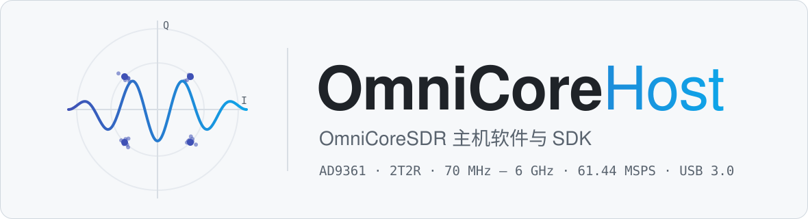
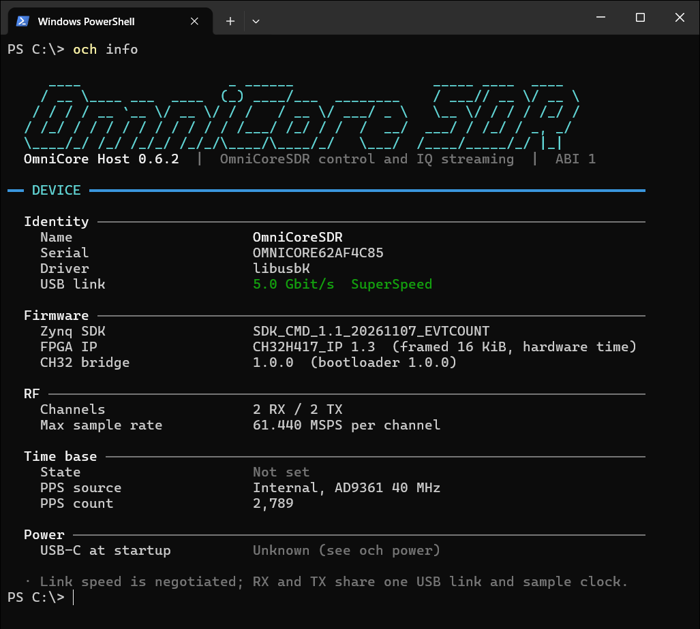
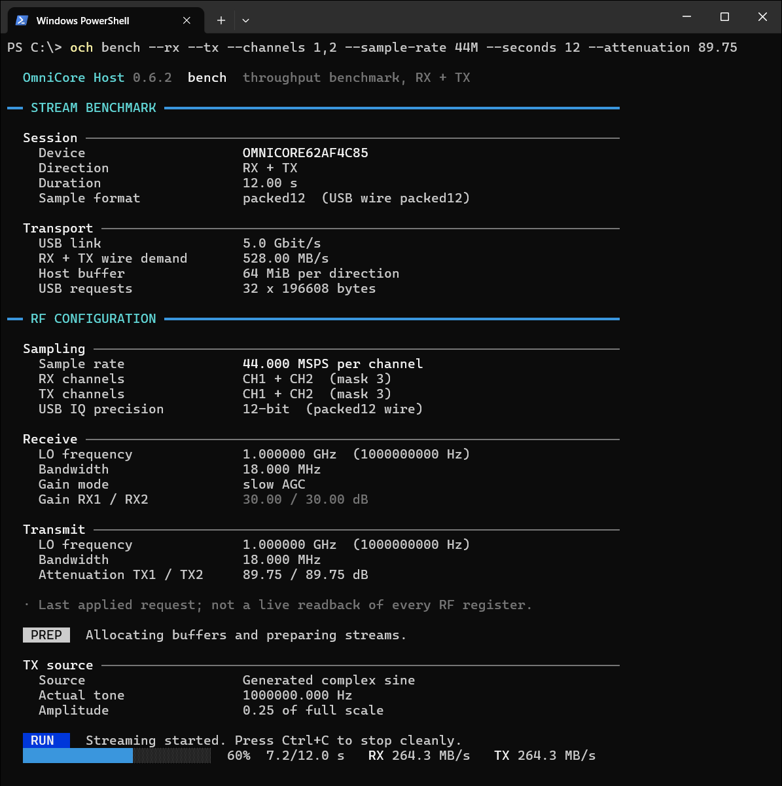
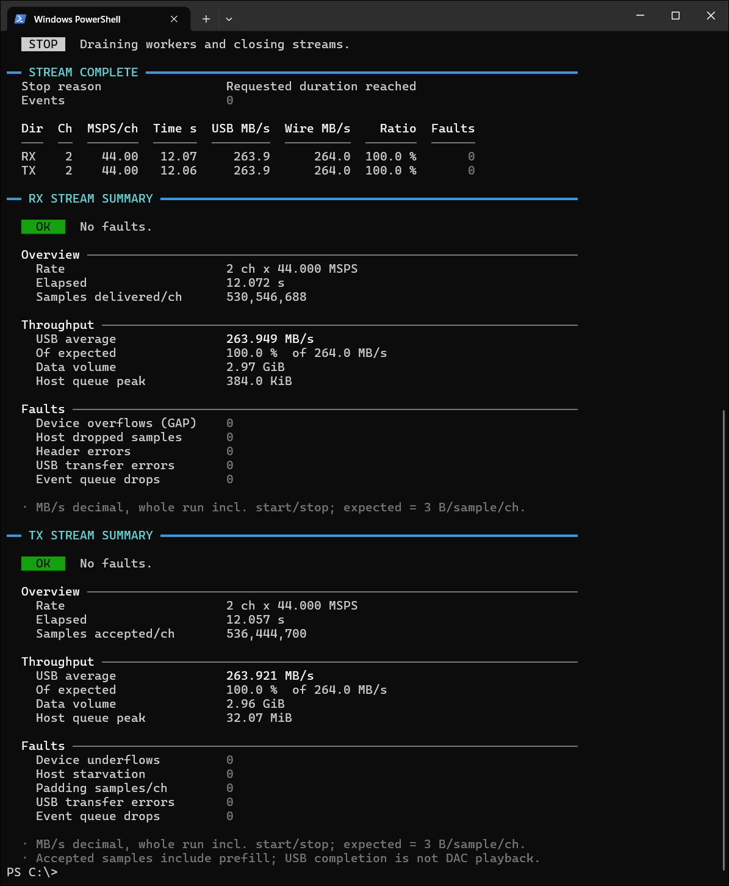
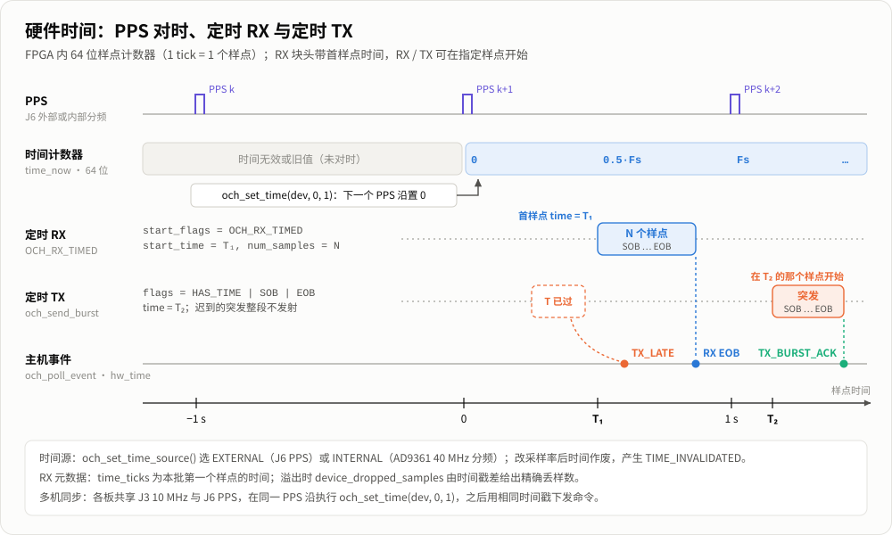
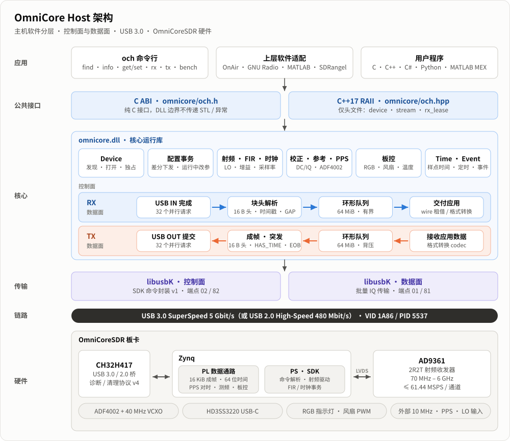

<div align="center">

<picture>
  <source media="(prefers-color-scheme: dark)" srcset="docs/images/zh-CN/banner-dark.svg">
  
</picture>

[](https://github.com/Liren66/OmniCore-SDR-Host/actions/workflows/ci.yml)
[](https://liren66.github.io/OmniCore-SDR-Host/zh-CN/)
[](https://github.com/Liren66/OmniCore-SDR-Host/releases)
[](LICENSE)
[](#快速上手)

**[在线文档](https://liren66.github.io/OmniCore-SDR-Host/zh-CN/)** · **[下载发布包](https://github.com/Liren66/OmniCore-SDR-Host/releases)** · **[更新记录](CHANGELOG.md)** · **[English](README.md)**

</div>

OmniCore Host（OCH）是 **OmniCoreSDR**（AD9361 + Zynq + CH32H417 USB 桥）的主机端软件：C++17 运行库、命令行工具 `och`、公共 C/C++ SDK、SoapySDR 插件和 MATLAB 工具箱。它负责设备发现、射频控制、连续 IQ 收发、硬件时间戳与吞吐测试。[OmniCore-SDR-OnAir](https://github.com/Liren66/OmniCore-SDR-OnAir)（OnAir 的 fork）已通过它原生支持 RX、TX 与全双工。

<p align="center"></p>

> [!IMPORTANT]
> 需要 Zynq 固件 **[v2026.11.07](https://github.com/Liren66/OmniCore-SDR-Firmware/releases/tag/v2026.11.07) 及以上**（成帧 USB 传输），推荐 **[v2026.11.08](https://github.com/Liren66/OmniCore-SDR-Firmware/releases/tag/v2026.11.08)**。多板同步需要 v2026.11.07.2 及以上，每次都读到 USB-C 电流需要桥接固件 1.0.1。见 [固件兼容性](docs/zh-CN/firmware-compatibility.md)。

## 亮点

- **满速收发**：USB 3.0 下 2T2R 最高 61.44 MSPS（8bit），12bit 为 44 MSPS；低采样率也可用 USB 2.0 High-Speed。[测试结果](docs/zh-CN/benchmarks.md)
- **精确的数据边界**：每个 16 KiB 块带块头和 64 位样点时间，丢样数精确可知，间断以 epoch 标记。
- **硬件时间**：PPS 对时、定时 RX、定时 TX 突发、带样点时间的事件。[硬件时间戳](docs/zh-CN/timestamps.md)
- **多板同步**：菊花链或公共 10 MHz + PPS，含锁定检查与 AD9361 多片同步。[多板同步](docs/zh-CN/multi-board-sync.md)
- **运行中改参**：改频率、增益、采样率或 FIR 不必销毁流，同频段切频约 4 ms。[API](docs/zh-CN/api.md#运行中修改参数)
- **时钟**：外部 10 MHz 参考、RX/TX 独立外部 LO、PPS 驯服 40 MHz 晶振。[参考与外部 LO](docs/zh-CN/reference-lo.md) · [PPS](docs/zh-CN/pps.md)
- **接入常用工具**：`och` 命令行、C ABI + C++ 包装、SoapySDR（GNU Radio、SDR++、SDRangel、Python）、MATLAB 与 Simulink。
- **USB 升级桥接固件**：`och firmware update`。[桥接固件升级](docs/zh-CN/firmware-update.md)

## 快速上手

### 1. 安装

从 [Releases](https://github.com/Liren66/OmniCore-SDR-Host/releases) 下载对应平台的发布包。

<details>
<summary><b>Windows 10/11 x64</b></summary>

运行 `OmniCoreHost-0.8.0-win64-setup.exe`，默认安装到 `C:\Program Files\OmniCore Host` 并加入 PATH。安装包含 `och.exe`、运行库、头文件、MinGW/MSVC 导入库、CMake 包配置、示例与文档，以及驱动助手：

```powershell
och-driver check      # 只检查，不修改系统
och-driver install    # 为 VID 1A86 / PID 5537 安装 libusbK（需 UAC）
```

驱动细节与日志见 [Windows 安装](packaging/windows/INSTALL_WINDOWS.zh-CN.txt)。

</details>

<details>
<summary><b>Linux x86_64</b></summary>

```bash
tar -xzf OmniCoreHost-0.8.0-linux-x86_64.tar.gz
sudo mkdir -p /opt/omnicore && sudo mv OmniCoreHost-linux /opt/omnicore/0.8.0
sudo ln -sfn /opt/omnicore/0.8.0/bin/och /usr/local/bin/och
sudo install -m 0644 /opt/omnicore/0.8.0/share/omnicore/60-omnicore.rules /etc/udev/rules.d/
sudo udevadm control --reload-rules
```

运行时需要系统的 `libusb-1.0-0`。USB 权限与源码构建见 [Linux 与 macOS 安装](docs/zh-CN/install.md)。

</details>

<details>
<summary><b>macOS 12+（通用二进制）</b></summary>

不需要驱动，也不需要 Homebrew（libusb 已静态链接）：

```bash
tar -xzf OmniCoreHost-0.8.0-macos-universal.tar.gz
xattr -dr com.apple.quarantine OmniCoreHost-macos   # 浏览器下载的归档会被 Gatekeeper 隔离
sudo mkdir -p /opt/omnicore && sudo mv OmniCoreHost-macos /opt/omnicore/0.8.0
sudo ln -sfn /opt/omnicore/0.8.0/bin/och /usr/local/bin/och
```

</details>

### 2. 连接设备

```powershell
och version        # 软件版本与 ABI
och find           # 枚举设备
och info           # 身份、固件版本、USB 链路、RF 能力、时间基准、电源
och selftest       # 数字接口自检（RX PRBS / TX 回环）
```

### 3. 收发 IQ

```powershell
# 双通道接收 5 秒：LO 1 GHz、每通道 15.36 MSPS，保存为 sc16
och rx --file rx.sc16 --format sc16 --channels 1,2 --lo-frequency 1G --sample-rate 15.36M --seconds 5

# 回放上述文件，循环发射 5 秒，TX 衰减 60 dB
och tx --file rx.sc16 --format sc16 --channels 1,2 --lo-frequency 1G --sample-rate 15.36M --loop --seconds 5 --attenuation 60

# 发射 1 MHz 基带测试音
och tx --tone 1M --amplitude 0.25 --channels 1 --lo-frequency 1G --sample-rate 15.36M --seconds 5 --attenuation 60

# 全双工吞吐测试（不读写文件）
och bench --rx --tx --channels 1,2 --sample-rate 30.72M --seconds 10
```

> [!NOTE]
> 发射命令会产生射频输出，请接负载或衰减后的测试回路。`Ctrl+C` 可随时停止；已有采集文件默认不覆盖（需 `--overwrite`）。

## 命令行

| 类别 | 命令 |
|---|---|
| 设备 | `find` · `info` · `power` · `version` · `selftest` |
| 控制 | `commands` · `get NAME` · `set NAME VALUE` · `action NAME` · `config [RF 选项]` |
| FIR / 时钟 | `fir status` · `fir rx\|tx load FILE` · `fir rx\|tx\|both on\|off` · `clock status` · `clock sample-rate HZ` |
| 数据流 | `rx --file PATH` · `tx --tone HZ` · `tx --file PATH [--loop]` · `bench --rx [--tx]` |
| 多板同步 | `sync --devices M,S1,...` · `sync --mode common` · `sync status` · `sync off` |
| 桥接固件 | `firmware [info]` · `firmware check FILE` · `firmware update FILE` · `firmware boot` · `firmware enter` |

全局选项：`--serial` 选择设备，`--json` 输出机器可读结果，`--no-color` 关闭颜色。数值支持 `k`/`M`/`G` 后缀，规范命令统一使用 Hz 和 dB。见 [命令行参考](docs/zh-CN/cli.md) 与 [命令目录](docs/zh-CN/commands.md)。

<table>
<tr>
<td width="50%" valign="top"></td>
<td width="50%" valign="top"></td>
</tr>
<tr>
<td align="center"><sub>运行中：会话信息、RF 配置和实时进度</sub></td>
<td align="center"><sub>结束时：吞吐汇总表与分组统计</sub></td>
</tr>
</table>

<details>
<summary><b>常用控制示例</b></summary>

```powershell
och set rx.lo-frequency 2.4G
och set tx1.attenuation 10
och config --sample-rate 30.72M --lo-frequency 1G --bandwidth 18M --gain 30

och set rx.dc-correction on          # RX 直流跟踪
och set clock.ref-source external    # 外部 10 MHz 参考（J3）
och set rx.lo-source external        # 外部 LO（RX: J11，TX: J10，输入为 2 倍 RF 频率）
och set pps.input-enabled on         # PPS 输入（J6）；无 10 MHz 时驯服晶振
och get clock.vcxo-status            # 调谐模式与 CH32 环路状态

och fir rx load filter.ftr && och fir rx on
och rssi on && och rssi --count 0 --interval 0.2   # RX1/RX2 RSSI（相对 dB）
och firmware update OmniCore-Bridge-1.0.1.ocfw      # 通过 USB 升级桥接固件，约 5 秒
```

</details>

<details>
<summary><b>IQ 文件格式与退出码</b></summary>

| 格式 | 每通道每样本 | 说明 |
|---|---:|---|
| `packed12` | 3 字节 | USB 原生 12bit |
| `sc16` | 4 字节 | int16 I/Q，小端；`rx`/`tx` 默认 |
| `fc32` | 8 字节 | float32 I/Q，归一化到 ±1 |
| `sc8` | 2 字节 | int8 I/Q，需要 `--iq-bits 8` |

双通道按 `I1,Q1,I2,Q2` 交织，文件无容器头。采集时旁边生成 `.metadata.jsonl`，记录配置、每个 epoch 的文件位置与硬件时间（`time_ticks`）以及精确丢样数——**溢出前后的数据不能当作连续采样拼接**，但可按 `time_ticks` 放回同一时间轴。

退出码：`0` 完成 · `1` 设备/传输错误 · `2` 参数错误 · `3` `bench --fail-fast` 提前结束 · `130` Ctrl+C 中断。性能是否达标请看 JSON 的 `stability.pass`，而非仅看退出码。

</details>

## 测试结果

`och bench` 零错误的最高采样率（OCH 0.6.1，Windows 11，USB 3.0；较高档位以 300 秒长测确认）：

| 配置 | 采样率 / 通道 | RX / TX MB/s |
|---|---:|---:|
| 1 RX 或 2 RX | 61.44 MSPS | 184.1 / — 或 368.5 / — |
| 1 RX + 1 TX | 61.44 MSPS | 183.9 / 183.8 |
| 1 RX + 2 TX | 58 MSPS | 174.2 / 348.3 |
| 2 RX + 1 TX | 58.5 MSPS | 351.3 / 175.7 |
| 2 RX + 2 TX · 12bit | 44 MSPS | 264.2 / 264.2 |
| 2 RX + 2 TX · 8bit | 61.44 MSPS | 245.2 / 245.1 |

上限来自 FPGA 与 CH32 之间约 533 MB/s 的 UHSIF 总线（RX + TX 共享）。USB 2.0 High-Speed 下的稳定档位为单通道 14 MSPS、2T2R 12bit 3.5 MSPS、2T2R 8bit 5 MSPS。结果与主机 USB 控制器、端口和线材有关，见 [测试结果](docs/zh-CN/benchmarks.md)。

## C/C++ 开发

`include/omnicore/och.h` 是纯 C ABI（不跨 DLL 传递 STL / 异常，便于 MSVC、MinGW、C#、Python、MATLAB MEX 调用）；`include/omnicore/och.hpp` 是仅头文件的 C++17 RAII 包装。

```cmake
find_package(OmniCoreHost 0.8 CONFIG REQUIRED)
target_link_libraries(myapp PRIVATE OmniCore::omnicore)
```

```cpp
#include <omnicore/och.hpp>

och::device dev;                         // 唯一设备；多台时传序列号
auto cfg = och::default_config();
cfg.sample_rate = 30720000;
cfg.rx_mask = 3;                         // RX1 + RX2
dev.configure(cfg);

och::stream rx(dev, och::stream_args(OCH_RX));
rx.start();
// rx.recv(...) 或 och::rx_lease 零拷贝读取；元数据中的 epoch / flags 标记数据间断
```

<details>
<summary><b>硬件时间：PPS 对时、定时 RX 与定时 TX</b></summary>



```c
och_set_time_source(dev, OCH_TIME_SOURCE_INTERNAL);     // 或 EXTERNAL（J6 PPS）
och_set_time(dev, 0, 1);                                // 下一个 PPS 沿把时间置 0

och_stream_args a; och_default_stream_args(&a, OCH_RX); // 定时 RX：t = T 起接收 N 个样点
a.start_flags = OCH_RX_TIMED; a.num_samples = N;
a.start_time_lo = (uint32_t)T; a.start_time_hi = (uint32_t)(T >> 32);

och_tx_metadata md = {sizeof md, OCH_TX_HAS_TIME | OCH_TX_START_OF_BURST | OCH_TX_END_OF_BURST, T2};
och_send_burst(tx, samples, n, &md, &accepted, 1000);   // 在样点时间 T2 发射
```

</details>

<details>
<summary><b>架构</b></summary>



</details>

示例：[接收](examples/receive.cpp) · [发射](examples/transmit.cpp) · [运行中改参](examples/reconfigure.cpp) · [8bit 全双工](examples/duplex_iq8.cpp) · [扫频瀑布图与实时演示](docs/zh-CN/sweep.md)。另见 [API 参考](docs/zh-CN/api.md)、[架构与性能](docs/zh-CN/architecture.md) 与 [从源码构建](docs/zh-CN/development.md)。

## GNU Radio 与 SoapySDR

`bindings/soapy/` 是驱动名为 `omnicore` 的 [SoapySDR](https://github.com/pothosware/SoapySDR) 插件，GNU Radio（gr-soapy）、SDR++、SDRangel 以及 SoapySDR 的 Python / C++ 接口都能直接使用这块板。插件要和本机的 SoapySDR 一起编译，所以只提供源码：

```bash
cmake -S . -B build -DOCH_BUILD_SOAPY=ON && cmake --build build -j
sudo cmake --install build --prefix /usr/local     # macOS（Homebrew）用 --prefix "$(brew --prefix)"
SoapySDRUtil --find="driver=omnicore"
```

GNU Radio 全双工时，source 和 sink 要写相同的 `rx_mask`、`tx_mask`。已在 macOS 实机验收，Linux、Windows 只在 CI 中编译。见 [SoapySDR 插件](docs/zh-CN/soapy.md)。

## MATLAB

`bindings/matlab/` 是支持 MATLAB R2018a+、不需要任何其他工具箱的工具箱：`omnicore.Device`、`RxStream` / `TxStream`，以及可用于 Simulink 的 `Receiver` / `Transmitter` System object。从发布页下载 `omnicore-matlab-<版本>-<平台>.zip`，加入路径即可：

```matlab
addpath('<解压目录>/omnicore-matlab');
dev = omnicore.Device('SampleRate', 30.72e6, 'RxFrequency', 2.45e9);
[x, meta] = receive(dev, 1e6);          % 1e6 x 2 complex single；meta 含硬件时间和丢样位置
delete(dev)
```

工具箱自带 MATLAB 帮助页面（`omnicore.doc`，英文，`doc/zh-CN/` 下有中文版）和完整示例：调频收音机、FM 自发自收、QPSK 视频传输、简易示波器，不接设备时可用 `'Simulate', true` 运行。见 [MATLAB 工具箱](docs/zh-CN/matlab.md)。

## 文档

完整文档见 **<https://liren66.github.io/OmniCore-SDR-Host/zh-CN/>**（源文件在 [`docs/zh-CN/`](docs/zh-CN/)，英文版在 [`docs/`](docs/)）。

| 入门 | 功能 | 集成 | 参考 |
|---|---|---|---|
| [安装](docs/zh-CN/install.md) | [硬件时间戳](docs/zh-CN/timestamps.md) | [C/C++ API](docs/zh-CN/api.md) | [命令目录](docs/zh-CN/commands.md) |
| [命令行参考](docs/zh-CN/cli.md) | [多板同步](docs/zh-CN/multi-board-sync.md) | [SoapySDR 插件](docs/zh-CN/soapy.md) | [设备协议](docs/zh-CN/protocol.md) |
| [排错](docs/zh-CN/troubleshooting.md) | [扫频瀑布图](docs/zh-CN/sweep.md) | [MATLAB 工具箱](docs/zh-CN/matlab.md) | [架构与性能](docs/zh-CN/architecture.md) |
| [桥接固件升级](docs/zh-CN/firmware-update.md) | [8bit USB IQ](docs/zh-CN/iq8.md) · [FIR 与时钟](docs/zh-CN/fir.md) | [Windows 安装](packaging/windows/INSTALL_WINDOWS.zh-CN.txt) | [测试结果](docs/zh-CN/benchmarks.md) |
| [固件兼容性](docs/zh-CN/firmware-compatibility.md) | [参考与外部 LO](docs/zh-CN/reference-lo.md) · [PPS](docs/zh-CN/pps.md) | [从源码构建](docs/zh-CN/development.md) | [板级控制](docs/zh-CN/board-control.md) · [更新记录](CHANGELOG.md) |

## 许可证

Copyright (C) 2026 OmniCoreSDR contributors。本工程源码采用 [GNU 通用公共许可证第 3 版或更新版本](LICENSE)（`SPDX-License-Identifier: GPL-3.0-or-later`），提交到本项目的贡献同样按此许可证授权。本程序按“原样”提供，不附带任何担保。libusbK、libwdi 等第三方组件沿用各自许可证，见 `third_party/driver/NOTICES.txt`。
