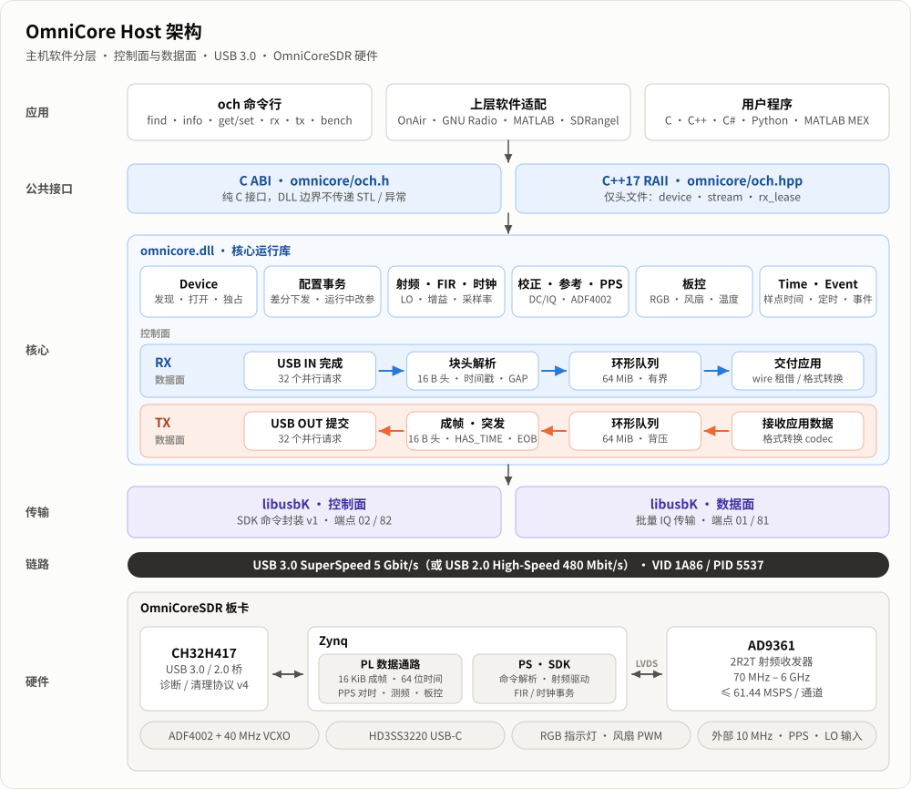
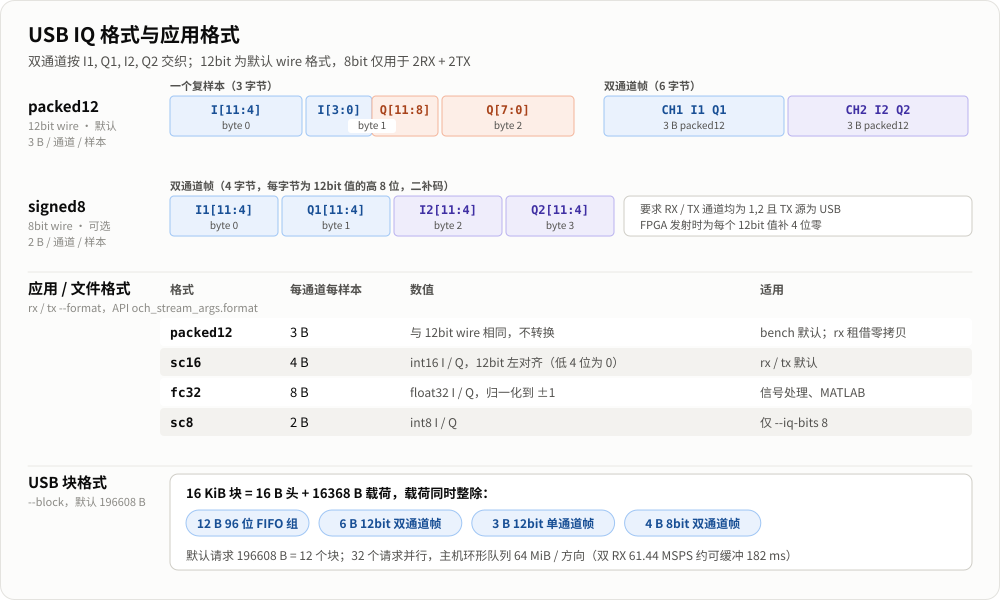
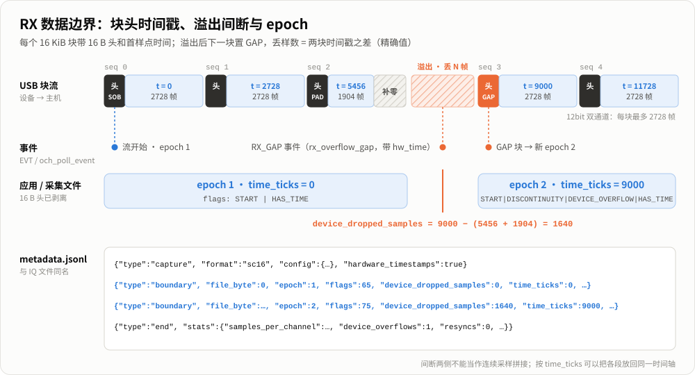

# 架构与性能设计

## 分层

~~~text
应用层：OnAir 原生数据源（后续）/ MATLAB / GNU Radio / 其他程序
                              │
                  C ABI：omnicore/och.h
                  C++：omnicore/och.hpp
                              │
       Device 控制 / 协调重配置 / Stream 生命周期 / Event 与 Metadata
                ┌─────────────┴──────────────┐
           RX 数据通路                    TX 数据通路
   USB完成 → 块头解析 → 有界环形队列  有界环形队列 → 成帧 → USB并行OUT
              ↓                           ↑
      当前wire租借 或应用格式转换     应用格式转当前wire
                └─────────────┬──────────────┘
                       libusbK 后端
                              │
             CH32H417 USB 3.0/2.0 ↔ FPGA ↔ AD9361
                         ZYNQ 控制接口
~~~

CLI 与应用适配层调用同一公共接口；SoapySDR 插件（`bindings/soapy/`，见 [SoapySDR 插件](soapy.md)）就是这样一个适配层，只使用公开 C 接口，由 `soapy_uses_public_api` 测试保证。公共 API 不暴露 libusbK 句柄、Windows OVERLAPPED 或 FPGA 寄存器，给未来后端留下替换空间。当前后端为 Windows libusbK 与 Linux libusb 1.0。0.3 为 OnAir 等持续收样应用补齐运行中改参的生命周期能力；本版不包含 OnAir 数据源实现；核心库本身不依赖 SoapySDR，插件是可选的单独模块。

控制面逐条发送 SDK 命令并分离异步 EVT；数据面使用独立的 RX/TX USB 请求队列和生产者/消费者。一个 RX 流只能有一个应用消费者，一个 TX 流只能有一个应用生产者。RX 与 TX 可以并发。设备配置、打开、关闭、创建/销毁流应由应用管理线程串行执行。

AD9361 硬件 FIR 和时钟链也属于控制面。CLI 在打开设备前解析 FTR，公共 C API 接收 signed16 数组，核心分块上传、提交 CRC 并检查 SDK 的验证结果。管理线程可通过 typed FIR/clock 接口协调重配，不在高速 IQ 处理线程里重配硬件。改变 Fs 会改变既有 FIR 的 Hz 频响，基座不把配置验证当作频响设计或测量。

## 设备协调重配置

设备对象拥有共享配置及双方流的协调权。应用保持流句柄和 IO 线程，在管理线程调用原有 configure，或 typed FIR、clock、sample-rate 设置接口。核心执行如下事务：

1. 校验请求；有流时拒绝改变任何方向的通道 mask 或 USB IQ 位数。有未释放的 RX 租借则返回 BUSY，硬件不变。同参数 configure 直接成功，不打断收发。
2. 保存双方原始运行状态，阻止新数据操作进入，唤醒正在等待的 recv/acquire/send；临时中断用 TIMEOUT 表达，已部分接受的 send 返回 OK。
3. 暂停原本运行的方向，取消并完成旧 USB 请求清理，清掉旧数据会话。配置、流句柄、格式及已分配的 USB/主机大缓冲各有明确所有者，不靠应用销毁流来改参。
4. 写入变更的 RF 参数或指定 FIR/clock 事务。configure 仅下发实际变化，减少重复时钟/带宽设置和无关校准。
5. 丢弃旧 RX 队列和旧 TX 排队/取消请求数据。活动 TX 预填 4 个零 IQ 块后，提前放行持续生产者补队列；先恢复 RX，最后启动 TX，发布成功事件。未 start 或已显式 stop 的流保持原状态。恢复失败时重新关闭 TX 数据入口并停止双方。

当前 CH32 跨会话清理约束仍存在，因此一次参数修改可能中断双方收发；这里没有声称无缝 LO 跳频或独立方向的时钟。调用方应把停顿作为正常数据间断处理。大缓冲保持分配可以避免每次调谐重新分配大块内存，但硬件校准、USB 调度和 SDK 响应仍决定实际恢复时间。单通道实机测试已验证原流继续收发及间断标记，不承诺固定毫秒延迟。

例外是只改 LO、RX 增益或 TX 衰减的请求（有 TX 流时，TX LO 变化除外）。这类请求跳过第 2、3、5 步，直接写参数，流不停；下一个 RX 块带 RECONFIGURED | DISCONTINUITY，见 [API 快速调谐](api.md#快速调谐046)。

RX 在恢复后的第一个成帧块开启下一个单调递增的 epoch，首块额外带 RECONFIGURED，并带 START、DISCONTINUITY 与 HAS_TIME。已知的主机队列丢弃计入 host_dropped_samples，重配原因不冒充设备溢出。块头时间戳照常给出；但改变采样率会使硬件时间作废（`OCH_EVENT_TIME_INVALIDATED`），需要重新对时。

TX 清除旧配置下的待发数据，不重放取消请求。只有原本正在发射的流在恢复前预填 4 个 transfer_bytes 大小的零 IQ 块，计入 tx_padding_samples。核心在启动硬件前解除 TX 的重配置阻塞，允许原生产者补充队列；RX 的启动控制交互先完成，TX 最后启动，避免固定零块在生产者仍被阻塞时耗尽。恢复不是精确 burst 边界，已接受的数据也可能在重配中被丢弃。没有活动 TX 的事务绝不自行启动发射。

硬件变更或恢复失败会停止双方并使配置缓存失效，不自动回滚发射。调用方保存错误，结束 IO 线程并销毁旧流，确认设备状态后显式重新 configure、创建和启动。原始 och_command 修改仍只允许没有流对象时执行，避免绕过协调器。

这是单个 SDK 设备对象内的协调机制。独立 och.exe 仍遵循设备独占，没有为另一个软件的现有流提供 IPC；OnAir 等应用需要在自己的数据源内持有同一个 OCH device，并把 UI 调参交给管理线程。原生数据源可直接使用 C ABI/C++ 包装；当前版本不包含第三方驱动加载层。

## 缓冲与复制

默认每方向配置 64 MiB 的有界主机缓冲、32 个 USB 请求、196608 B 请求长度（12 个成帧块）。USB 请求长度须为 16384 B 的倍数：每个 16 KiB 块 = 16 B 头 + 16368 B 载荷，载荷同时整除 12bit 双通道 6 B 帧、单通道 3 B 帧和 8bit 双通道 4 B 帧，因此块内总是整数个样点。定时 RX（`OCH_RX_TIMED`）改用 128 个 16 KiB 请求：CH32 桥在最后一块后不发短包，较大的请求会让有限长度突发的末块一直挂在未完成的请求里。请求缓冲和主机环形队列在开始前分配，避免不断创建 USB 请求。

Windows 和 USB 调度不提供硬实时截止时间保证。设计目标是用并行请求、有限缓冲和可观察的错误状态提高持续收发的稳定性；超过缓冲余量的停顿仍需要上层按间断恢复。

och_rx_acquire/release 暴露已经去除头的当前 wire 内存区（默认 packed12，显式 8bit 为 SC8），省去向应用缓冲再次复制和格式转换。它不是 USB DMA 到应用的端到端零拷贝：USB 完成缓冲到核心队列仍有复制。租借期间不得同时 recv/acquire/destroy 同一流。长时间持有租借会消耗缓冲余量，适配器应尽快处理或复制到自己的受控队列后释放。

双 RX 61.44 MSPS 为 368.64 MB/s，64 MiB 大约覆盖 182 ms。缓冲可吸收短暂停顿，无法让低于平均数据率的下游无限接收。RX 队列满时保留已经排队/租借的内容并丢弃新到数据，不覆盖消费者正在读取的内存；恢复交付时报告主机丢样统计及间断元数据。TX 队列满时对应用 send 施加背压，可能部分接受或超时。

| 模式 | 每方向 wire 速率 |
|---|---:|
| 双 RX 61.44 MSPS | RX 368.64 MB/s |
| 双 TX 61.44 MSPS | TX 368.64 MB/s |
| 双 RX + 双 TX 30.72 MSPS | RX/TX 各 184.32 MB/s |
| 单 RX + 单 TX 61.44 MSPS | RX/TX 各 184.32 MB/s |
| 8bit 双 RX + 双 TX 30.72 MSPS | RX/TX 各 122.88 MB/s |

上表未注明 8bit 的行均为默认 12bit。sc16 输出每通道每复样本 4 B，fc32 为 8 B，应用格式大小不受 wire 位数影响；双 RX 满速保存对应约 491.52 MB/s 和 983.04 MB/s。磁盘、文件系统缓存和插件处理能力必须单独考虑。bench 使用当前 wire 租借/释放且不写盘，便于区分 USB/核心能力与磁盘或转换开销。8bit 的格式、能力与启动水位约束见 [8bit 扩展](iq8.md)。

## RX 成帧与间断

0.6.0 起 USB 上只有成帧格式（需要 FPGA `CH32H417_IP` 1.3）。每个 16 KiB 块以 16 B 头开始：魔数 `'OC'`、标志、校验、16 位块序号、有效帧数和 64 位首样点时间，格式见 [设备协议](protocol.md#成帧块格式)。核心逐块校验头部，只把有效帧交给消费者；块头本身不进入 IQ 数据。

- **连续性**：下一块的时间应等于上一块的时间加有效帧数。时间连续且没有 SOB/GAP/LATE 标志时，数据属于同一个 epoch。
- **设备溢出**：FPGA FIFO 满时，当前块补零结束，下一块带 GAP 标志。核心开启新 epoch，置 DISCONTINUITY | DEVICE_OVERFLOW，`device_dropped_samples` = 新块时间 − 预期时间，是**精确值**。RX 不再重启，TX 不受影响。
- **校验失败**：头部魔数或校验错误时，核心按字节重新搜索合法块头并计入 `resyncs`。正常运行时该计数应为 0。
- **主机溢出**：环形队列满时丢弃新数据，计入 `host_dropped_samples` 并置 HOST_OVERFLOW | DISCONTINUITY；时间戳继续推进，丢样数同样准确。

同一次 recv 不跨 epoch 或已知间断。应用应在 START/DISCONTINUITY 上重置需要连续相位的处理状态；`time_ticks` 可把各段放回同一时间轴。硬件时间、定时 RX/TX 的用法见 [硬件时间戳](timestamps.md)。

## TX 的显式启动与停止

应用先创建 TX 流并 send 数据预填，再 start 显式发射。CLI 在 start 前已启动生产者，并积累最多 32 MiB wire 数据，避免控制命令往返和线程启动耗时超过几块预填数据的播放时间。正常欠供时不会隐藏生成连续零样本；协调重配置仅为恢复原本活动的 TX 插入上述有界预填零块，并保留可观察统计。未启动的流不会自动启动射频。CLI 使用预生成且周期闭合的复数正弦，避免在实时循环内调用 sin/cos。

start 时核心先等待 FPGA TX FIFO 达到约一个成帧块（每块组数 − 16），再请求 SDK 开始播放；成帧后的 TX 由 FPGA 从第一块开始连续播放。

文件结束调用 flush：只为 16 KiB 块对齐补入必要的零 IQ，数量记入 tx_padding_samples，并等待已提交 OUT 完成。持续源按时停止则先关闭硬件，取消剩余队列，不故意排空使 TX 在停止前饿死。USB 完成表示设备接收了传输，不等于某个样本已经从 DAC 发出；accepted 样本数仅是进入主机队列的量。需要精确时隙发射时使用 `och_send_burst`：带 HAS_TIME 的突发在指定样点开始，结束时产生带样点时间的 `OCH_EVENT_TX_BURST_ACK`，迟到的突发不发射并产生 `OCH_EVENT_TX_LATE`。

因此有限文件 EOF 在排空到关闭硬件的间隙可能产生尾部欠流及主机欠供事件。它们保留在日志与统计中，由调用方根据 EOF 状态识别，不能静默抹去，也不能与连续流中段错误混为一个验收结论。

流对象显式 stop 后不复用，应销毁后重新创建。受当前 CH32 USB 中止后状态约束，一方向停止后要重开该方向，需先停止另一方向，以便清理跨会话缓冲；核心会拒绝不满足条件的重开。运行中改参使用设备协调器同时处理双方和跨会话清理，属于内部暂停/恢复，不等同于应用显式 stop。

## 插件扩展边界

后续插件负责第三方软件的设备枚举、参数映射、缓冲策略和数据类型转换。它可以使用 C++ 包装，也可以直接调用 C ABI。硬件公共状态（共享采样率、射频 LO、通道 mask）由设备对象管理，不能由不同插件假定独立时钟。

适配器必须向上层传播间断、设备错误、主机队列溢出和 TX 欠供，不可只交付 IQ 而丢弃元数据。0.6.0 起每批 RX 样点带硬件时间（`time_ticks`），适配器应向上层传递，以支持定时收发和 PPS 对时。多设备同步需要共享 J3 10 MHz 和 J6 PPS；本版未实现 AD9361 多芯片同步（MCS），各板 LO 相位不相干。
