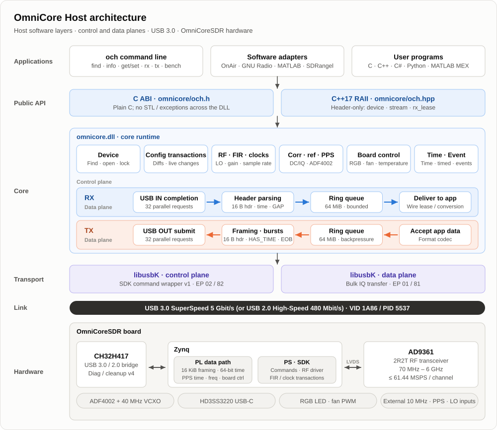
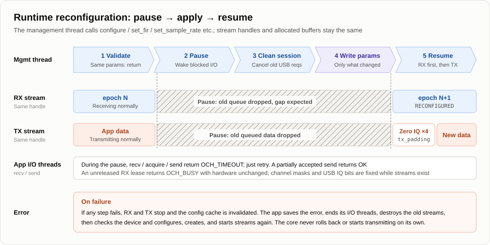
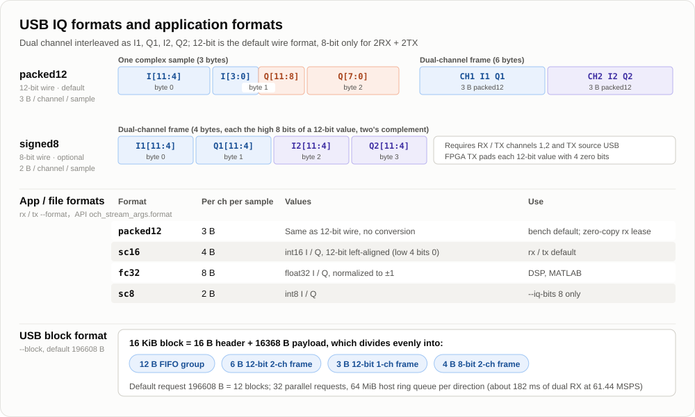
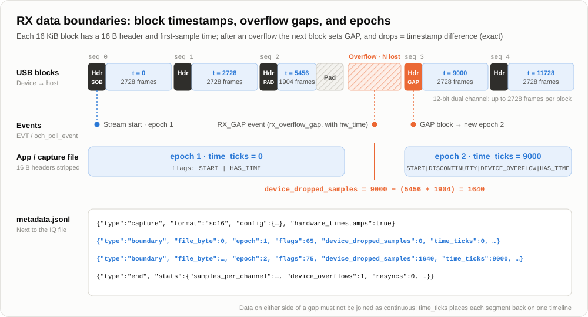

# Architecture and Performance Design

## Layers

~~~text
Applications: OnAir (native) / MATLAB / GNU Radio (SoapySDR) / other programs
                              │
                  C ABI: omnicore/och.h
                  C++:   omnicore/och.hpp
                              │
   Device control / coordinated reconfiguration / Stream lifetime / Events and metadata
                ┌─────────────┴──────────────┐
          RX data path                   TX data path
 USB completion → header parse →    bounded ring queue → framing →
     bounded ring queue                 parallel USB OUT
              ↓                           ↑
   lease of current wire format   application format → current wire
   or application format conversion
                └─────────────┬──────────────┘
     libusbK backend (Windows) / libusb backend (Linux, macOS)
                              │
             CH32H417 USB 3.0/2.0 ↔ FPGA ↔ AD9361
                      ZYNQ control interface
~~~

The CLI and application adapters call the same public interface. The SoapySDR plugin (`bindings/soapy/`, see [SoapySDR Plugin](soapy.md)) and the MATLAB toolbox (`bindings/matlab/`, see [MATLAB Toolbox](matlab.md)) are such adapters: they only use the public C interface, enforced by the `bindings_use_public_api` test, and share the mapping and streaming logic in `bindings/common/`. The public API does not expose libusbK handles, Windows OVERLAPPED, or FPGA registers, leaving room to replace the backend in the future. The current backends are Windows libusbK and libusb 1.0 shared by Linux / macOS. The runtime reconfiguration lifecycle ("Device-coordinated reconfiguration" below) is designed for applications that receive samples continuously. [OmniCore-SDR-OnAir](https://github.com/Liren66/OmniCore-SDR-OnAir) is a fork of OnAir that calls the C ABI directly for native support, including RX, TX, and full duplex; it is released separately and is not in this repository. The core library itself does not depend on SoapySDR; the plugin is an optional separate module.

The control plane sends SDK commands one at a time and separates asynchronous EVTs; the data plane uses independent RX/TX USB request queues and producers/consumers. An RX stream can have only one application consumer, and a TX stream only one application producer. RX and TX can run concurrently. Device configuration, open, close, and creating/destroying streams should be done serially from an application management thread.

The AD9361 hardware FIR and clock chain also belong to the control plane. The CLI parses FTR before opening the device, the public C API accepts signed16 arrays, and the core uploads in chunks, submits the CRC, and checks the SDK's verification result. The management thread can coordinate reconfiguration through the typed FIR/clock interfaces; hardware is never reconfigured from the high-speed IQ processing threads. Changing Fs changes the frequency response in Hz of an existing FIR, and the core does not treat configuration verification as frequency-response design or measurement.

## Device-coordinated reconfiguration

The device object owns the shared configuration and coordinates the streams in both directions. The application keeps its stream handles and I/O threads, and calls the existing configure, or the typed FIR, clock, and sample-rate setters, from its management thread. The core performs the following transaction:

1. Validate the request; while streams exist, reject changes to the channel mask of either direction or to the USB IQ bit width. If an RX lease has not been released, return BUSY without touching the hardware. A configure with identical parameters succeeds immediately without interrupting streaming.
2. Save the original running state of both directions, block new data operations from entering, and wake any recv/acquire/send that is waiting; the temporary interruption is expressed as TIMEOUT, and a send that has been partially accepted returns OK.
3. Pause the directions that were running, cancel and finish cleaning up the old USB requests, and clear the old data session. The configuration, stream handles, formats, and already allocated large USB/host buffers each have a clear owner; changing parameters does not rely on the application destroying streams.
4. Write the changed RF parameters or the given FIR/clock transaction. configure only sends what actually changed, reducing repeated clock/bandwidth settings and unrelated calibrations.
5. Discard the old RX queue and the old TX queued/cancelled request data. For an active TX, prefill 4 zero-IQ blocks, then let the continuous producer start refilling the queue early; resume RX first and start TX last, then publish a success event. Streams that were not started, or were explicitly stopped, keep their state. If resuming fails, close the TX data entry again and stop both directions.

The current CH32 cross-session cleanup constraint still applies, so a single parameter change may interrupt streaming in both directions; this is not a claim of seamless LO hopping or per-direction clocks. Callers should handle the pause as a normal data discontinuity. Keeping the large buffers allocated avoids reallocating large blocks of memory on every tune, but hardware calibration, USB scheduling, and SDK responses still determine the actual recovery time. Single-channel hardware tests have verified that the original streams keep running and that discontinuities are marked; no fixed millisecond latency is promised.

The exception is a request that only changes the LO, RX gain, or TX attenuation (except a TX LO change while a TX stream exists). Such requests skip steps 2, 3, and 5 and write the parameter directly without stopping the stream; the next RX block carries RECONFIGURED | DISCONTINUITY. See [API: Fast tuning](api.md#fast-tuning).

After resuming, RX starts the next monotonically increasing epoch at the first framed block; that first block additionally carries RECONFIGURED, along with START, DISCONTINUITY, and HAS_TIME. Known host queue drops are counted in host_dropped_samples, and a reconfiguration is never reported as a device overflow. Block header timestamps are provided as usual, but changing the sample rate invalidates the hardware time (`OCH_EVENT_TIME_INVALIDATED`), which then needs to be aligned again.

TX discards data pending under the old configuration and does not replay cancelled requests. Only a stream that was transmitting before is prefilled with 4 zero-IQ blocks of transfer_bytes each before resuming, counted in tx_padding_samples. The core lifts the TX reconfiguration block before starting the hardware, letting the original producer refill the queue; the RX start control exchange completes first and TX starts last, so the fixed zero blocks are not used up while the producer is still blocked. Resuming is not an exact burst boundary, and data already accepted may also be discarded during reconfiguration. A transaction with no active TX never starts transmitting on its own.

If a hardware change or resume fails, both directions are stopped and the configuration cache is invalidated; transmission is not rolled back automatically. The caller saves the error, ends the I/O threads, destroys the old streams, and after confirming the device state explicitly configures, creates, and starts again. Raw och_command modifications are still only allowed when no stream objects exist, so they cannot bypass the coordinator.

This is a coordination mechanism inside a single SDK device object. Separate och processes still respect device exclusivity, and no IPC is provided for another program's existing streams; applications like OnAir need to hold the same OCH device inside their own data source and hand UI parameter changes to the management thread. Native data sources can use the C ABI / C++ wrapper directly.

## Buffering and copying

By default each direction is configured with a 64 MiB bounded host buffer, 32 USB requests, and a request length of 196608 B (12 framed blocks). USB request lengths must be a multiple of 16384 B: each 16 KiB block = 16 B header + 16368 B payload, and the payload divides evenly into 12-bit dual-channel 6 B frames, single-channel 3 B frames, and 8-bit dual-channel 4 B frames, so a block always contains a whole number of samples. Timed RX (`OCH_RX_TIMED`) uses 128 requests of 16 KiB instead: the CH32 bridge sends no short packet after the last block, so with larger requests the final block of a finite-length burst would stay stuck in an incomplete request. Request buffers and the host ring queues are allocated before starting, avoiding constantly creating USB requests.

Windows and USB scheduling provide no hard real-time deadline guarantees. The design goal is to improve the stability of continuous streaming with parallel requests, bounded buffers, and observable error states; stalls longer than the buffer headroom still need the upper layer to recover from a discontinuity.

och_rx_acquire/release expose the current wire-format memory with headers already removed (packed12 by default, SC8 when 8-bit is explicitly selected), saving another copy into the application buffer and the format conversion. This is not end-to-end zero-copy from USB DMA to the application: there is still a copy from the USB completion buffer into the core queue. While a lease is held, the same stream must not be recv'd/acquired/destroyed concurrently. Holding a lease for a long time consumes buffer headroom; adapters should process it quickly, or copy it into their own controlled queue and release it.

Dual RX at 61.44 MSPS is 368.64 MB/s, and 64 MiB covers about 182 ms. Buffers can absorb short stalls but cannot let a downstream slower than the average data rate receive indefinitely. When the RX queue is full, content already queued/leased is kept and newly arriving data is dropped, so memory a consumer is reading is never overwritten; when delivery resumes, host drop statistics and discontinuity metadata are reported. When the TX queue is full, backpressure is applied to the application's send, which may be partially accepted or time out.

| Mode | Wire rate per direction |
|---|---:|
| Dual RX 61.44 MSPS | RX 368.64 MB/s |
| Dual TX 61.44 MSPS | TX 368.64 MB/s |
| Dual RX + dual TX 30.72 MSPS | RX/TX 184.32 MB/s each |
| Single RX + single TX 61.44 MSPS | RX/TX 184.32 MB/s each |
| 8-bit dual RX + dual TX 30.72 MSPS | RX/TX 122.88 MB/s each |

Rows in the table not marked 8-bit use the default 12-bit. sc16 output is 4 B per complex sample per channel and fc32 is 8 B; the application format size does not depend on the wire bit width, so saving dual RX at full speed corresponds to about 491.52 MB/s and 983.04 MB/s respectively. Disk, file system cache, and plugin processing capacity must be considered separately. bench uses leases/release of the current wire format and does not write to disk, making it easier to separate USB/core capacity from disk or conversion overhead. For the 8-bit format, capabilities, and start threshold constraints, see [8-bit extension](iq8.md).

## RX framing and discontinuities

Since 0.6.0, the framed format is the only format on USB (requires FPGA `CH32H417_IP` 1.3). Each 16 KiB block starts with a 16 B header: magic `'OC'`, flags, checksum, 16-bit block sequence number, valid frame count, and 64-bit time of the first sample; see [Device Protocol](protocol.md#framed-block-format) for the format. The core verifies the header of every block and only passes valid frames to the consumer; the block headers themselves never enter the IQ data.

- **Continuity**: the next block's time should equal the previous block's time plus its valid frame count. When the time is continuous and there are no SOB/GAP/LATE flags, the data belongs to the same epoch.
- **Device overflow**: when the FPGA FIFO is full, the current block is finished with zero padding and the next block carries the GAP flag. The core starts a new epoch and sets DISCONTINUITY | DEVICE_OVERFLOW, with `device_dropped_samples` = new block time − expected time, an **exact value**. RX no longer restarts, and TX is not affected.
- **Checksum failure**: when the header magic or checksum is wrong, the core searches byte by byte for a valid block header and counts it in `resyncs`. This count should be 0 in normal operation.
- **Host overflow**: when the ring queue is full, new data is dropped, counted in `host_dropped_samples`, and HOST_OVERFLOW | DISCONTINUITY is set; timestamps keep advancing, so the drop count is exact as well.

A single recv never spans an epoch or a known discontinuity. Applications should reset processing state that needs continuous phase on START/DISCONTINUITY; `time_ticks` lets the segments be placed back on the same timeline. For using hardware time and timed RX/TX, see [Hardware Timestamps](timestamps.md).

## Explicit TX start and stop

The application first creates a TX stream and sends data to prefill it, then calls start to transmit explicitly. The CLI starts its producer before start and accumulates up to 32 MiB of wire data, so that the control command round trip and thread start-up time do not exceed the playback time of a few prefilled blocks. Normal starvation never silently generates continuous zero samples; coordinated reconfiguration only inserts the bounded zero prefill blocks described above to resume a TX that was active, and keeps observable statistics. A stream that was not started never starts RF on its own. The CLI uses a pre-generated complex sine with a closed period, avoiding calls to sin/cos inside the real-time loop.

On start, the core first waits for the FPGA TX FIFO to reach about one framed block (groups per block − 16), then asks the SDK to start playback; after framing, the FPGA plays TX continuously from the first block.

At the end of a file, flush is called: it only pads the zero IQ needed to align to a 16 KiB block, counts it in tx_padding_samples, and waits for submitted OUT transfers to complete. A continuous source that stops on time closes the hardware first and cancels the remaining queue, rather than deliberately draining it and starving TX before it stops. A USB completion means the device received the transfer, not that a given sample has left the DAC; the accepted sample count is only the amount that entered the host queue. For transmission in exact time slots, use `och_send_burst`: a burst with HAS_TIME starts at the given sample, its end produces an `OCH_EVENT_TX_BURST_ACK` with the sample time, and a late burst is not transmitted and produces `OCH_EVENT_TX_LATE`.

So at the EOF of a finite file, the gap between draining and closing the hardware may produce trailing underflow and host starvation events. They are kept in the log and statistics, and the caller identifies them using the EOF state; they must not be silently erased, nor lumped together with errors in the middle of a continuous stream into a single acceptance verdict.

A stream object is not reused after an explicit stop; destroy it and create a new one. Because of the CH32 state after a USB abort, reopening a direction after it has stopped requires stopping the other direction first so the cross-session buffers can be cleaned up; the core rejects reopens that do not meet this condition. Runtime reconfiguration uses the device coordinator to handle both directions and the cross-session cleanup together; it is an internal pause/resume and is not the same as an explicit application stop.

## Plugin extension boundaries

Future plugins are responsible for device enumeration, parameter mapping, buffering policy, and data type conversion for third-party software. They can use the C++ wrapper or call the C ABI directly. Shared hardware state (shared sample rate, RF LO, channel masks) is managed by the device object, and different plugins must not assume independent clocks.

Adapters must propagate discontinuities, device errors, host queue overflows, and TX starvation to the upper layer, and must not deliver only the IQ while dropping the metadata. Since 0.6.0, every batch of RX samples carries hardware time (`time_ticks`), which adapters should pass upward to support timed RX/TX and PPS time alignment. Multi-device sync is done by `och_multi_sync` (shared 10 MHz, AD9361 multi-chip sync MCS, common time loading); see [Multi-Board Sync](multi-board-sync.md). MCS only aligns the sample clocks, and the LO phases of different boards remain incoherent.
