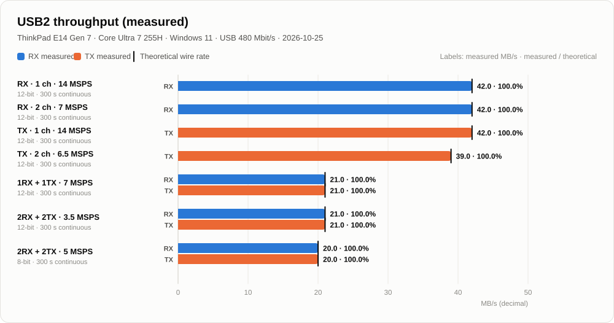

# Benchmarks

This page collects measured data for OmniCore Host: USB throughput (USB3 / USB2, Windows / Linux) and functional tests.

> [!NOTE]
> The results below come from the hosts listed. USB throughput depends on the host controller, port, and cable; after changing setups, recheck `stability.pass` with `och bench --json`. The tests only cover the data link and control functions, not RF metrics such as RF power, EVM, or sensitivity.

## How results are computed

Throughput is measured with `och bench` and averaged over the whole stream lifetime (including start/stop overhead); MB/s is decimal. Theoretical wire rate = sample rate × channels × bytes per sample (3 for 12-bit, 2 for 8-bit). "Errors" is the sum of host drops, USB transfer errors, device overflows / underflows, lost events, and TX starvation.

## USB 3.0 · Windows · framed transport (current)

Firmware v2026.11.07.1 (`CH32H417_IP` 1.3, same bitstream as v2026.11.07), OCH 0.6.1, Windows 11, USB 3.0, 2026-11-07. Highest sample rate with zero errors in `och bench`: first a fine sweep in 0.5 MS/s steps (10 s × 2–3 runs per setting), then a 300-second run at the highest setting. USB MB/s includes the 16 B header per block; the theoretical value does not.

| Configuration | Sample rate / channel | Test | RX / TX MB/s | Theoretical MB/s | Errors |
|---|---:|---|---:|---:|---:|
| 1 RX | 61.44 MSPS | 5 s | 184.1 / — | 184.3 | 0 |
| 2 RX | 61.44 MSPS | 60 s | 368.5 / — | 368.6 | 0 |
| 1 RX + 1 TX | 61.44 MSPS | 5 s | 183.9 / 183.8 | 184.3 | 0 |
| 1 RX + 2 TX | **58 MSPS** | 300 s | 174.2 / 348.3 | 174.0 / 348.0 | 0 |
| 2 RX + 1 TX | **58.5 MSPS** | 300 s × 2 | 351.3 / 175.7 | 351.0 / 175.5 | 0 |
| 2 RX + 2 TX · 12-bit | **44 MSPS** | 300 s × 2 | 264.2 / 264.2 | 264.0 | 0 |
| 2 RX + 2 TX · 8-bit | 61.44 MSPS | 60 s | 245.2 / 245.1 | 245.8 | 0 |

The limit comes from the UHSIF bus between the FPGA and the CH32: RX and TX share about 533 MB/s, and total traffic of 522–528 MB/s is stable. Results one step higher: 2T2R 12-bit at 44.5 MSPS and 1T2R at 59 MSPS showed RX overflows / TX underflows; 2T1R at 58.5 MSPS passed 10 s but had 1 RX overflow and 3 TX underflows within 300 s. The setting search at the 0.6.0 release (61.44 / 56 / 50 / 46 / 42) skipped these intermediate rates, which is why 56 and 42 MSPS were recorded at that time. The block header overhead (16 / 16384 ≈ 0.1%) has no measurable effect on bandwidth. `tools/bench_sweep.py` now uses the fine sweep and can reproduce this table.

## USB 2.0 High-Speed

On USB2, RX and TX share a 480 Mbit/s link budget. `usb2_reference` in the CLI's `och info --json` and the reference hints shown when a stream starts both come from the data in this section (`apps/och/usb2_reference.hpp`). USB2 needs CH32 firmware with USBHS support; see [Firmware Compatibility](firmware-compatibility.md#features-that-need-several-components-updated-together).



### Retest with framed transport (OCH 0.7.1, 2026-11-08)

OmniCore Host 0.7.1, Zynq firmware `SDK_CMD_1.2_20261107_SYNC` (framed transport, board running OmniCore SDR Linux 1.3.1), CH32 bridge 1.0.1 (v2026.11.08), ordinary USB 2.0 Type-A port, 480 Mbit/s. Each of the settings from the 300-second runs below was run continuously for 30 s:

| Configuration | USB IQ | Sample rate MSPS/channel | RX / TX MB/s | Faults |
|---|---:|---:|---:|---:|
| 1 RX | 12-bit | 14 | 42.0 / — | 0 |
| 2 RX | 12-bit | 7 | 42.0 / — | 0 |
| 1 TX | 12-bit | 14 | — / 42.0 | 0 |
| 2 TX | 12-bit | 6.5 | — / 39.0 | 0 |
| 1 RX + 1 TX | 12-bit | 7 | 21.0 / 21.0 | 0 |
| 2 RX + 2 TX | 12-bit | 3.5 | 21.0 / 21.0 | 0 |
| 2 RX + 2 TX | 8-bit | 5 | 20.0 / 20.0 | 0 |

- The 16-byte block header takes only 0.1% of bandwidth, so the USB2 settings are unchanged with framed transport. Each item ran for 30 s this time; the 300-second runs were not repeated.
- RX PRBS and TX loopback self-tests passed; `och firmware info` works normally.
- USB-C status queried over EP3 OUT (the USB2 endpoint in bridge 1.0.1): `och info` could read it 10 times in a row, about 0.1 s each. An ordinary USB2 Type-A port does not advertise 1.5 A / 3 A and shows `USB default current` (register 08=0x00); the same board on a USB3 Type-C port shows 3000 mA (08=0x30).

### 300-second runs (OCH 0.4.3, 2026-10-25)

| Configuration | USB IQ | Stable sample rate MSPS/channel | RX / TX MB/s | Start-up recoveries | New errors after 1 s |
|---|---:|---:|---:|---:|---:|
| 1 RX | 12-bit | **14** | 41.998 / — | 2 | 0 |
| 2 RX | 12-bit | **7** | 41.998 / — | 0 | 0 |
| 1 TX | 12-bit | **14** | — / 41.987 | 0 | 0 |
| 2 TX | 12-bit | **6.5** | — / 38.988 | 0 | 0 |
| 1 RX + 1 TX | 12-bit | **7** | 20.999 / 20.993 | 1 | 0 |
| 2 RX + 2 TX | 12-bit | **3.5** | 20.999 / 20.993 | 0 | 0 |
| 2 RX + 2 TX | 8-bit | **5** | 19.999 / 19.994 | 1 | 0 |

Each item ran continuously for 300 s; single-channel uses CH1, dual-channel uses CH1 + CH2, and sample rates are per channel. The test host was a ThinkPad E14 Gen 7 / Core Ultra 7 255H / Windows 11 (build 26200), with the libusbK USB driver and firmware `SDK_CMD_1.0_20261024_IQ8`.

### Test conditions

- `bench` uses native packed12 or signed8, with the default 64 MiB buffer and 32 × 196608 B USB requests per direction; no disk writes or application format conversion.
- RX/TX LO at 1 GHz, bandwidth 18 MHz; TX is a 1 MHz complex sine, amplitude 0.25, attenuation 60 dB.
- Sample rates were chosen in 0.5 MSPS steps; the table shows the stable settings that completed the 300-second test on this machine.
- RX overflow with full recovery is allowed within the first second, with zero new errors after that; average throughput must be at least 98% of the theoretical wire rate.
- Start-up overflows must be observed within the first second (as `RX GAP` events since 0.6.0; as overflow notifications and resyncs in the 0.4.x tests), and raw counts are kept. TX underflow, host drops, transfer errors, lost events, TX starvation, or zero padding at any stage count as failures.

`observed_seconds` is the host observation time when the CLI picked up the event, measured from the return of the stream start call; it is not hardware sample time. RX/TX share the device fault counts, so the counts of the two directions must not be added together. This run verified transport statistics, not RF waveform accuracy or bit-level continuity; a different host or USB topology needs to be confirmed again.

### Terminal output

`och info` uses the same device information layout on USB2 and USB3. The sample-rate table lives in the documentation, and the JSON keeps the measured reference for scripts.


300-second test of 8-bit dual-channel full duplex at 5 MSPS, with 1 start-up recovery and zero new errors afterwards:


The terminal images were drawn from the measurement records by the CLI's own display code; omitted sections are marked with `...`.

### Reproducing

```powershell
och bench --rx --tx --channels 1,2 --sample-rate 3.5M --seconds 300 --attenuation 60 --fail-fast
och bench --rx --tx --channels 1,2 --iq-bits 8 --sample-rate 5M --seconds 300 --attenuation 60 --fail-fast
```

`--fail-fast` stops the stream normally after the first second when it observes two RX overflow notifications no more than 2 s apart, saves the statistics, and returns exit code 3; recovery notifications are not counted twice. Candidates that do not trigger an early stop run for the full requested duration.

## Functional tests

| Item | Platform | Result |
|---|---|---|
| Hardware timestamps (0.6.0) | Windows | All 6 checks of `hw_timestamp_test` pass: internal PPS interval exactly equals the sample rate (61.44 / 30.72 / 7.68 MSPS), PPS loading is exact, RX timestamps are continuous, the first sample of timed RX is exact, timed TX through the data-port loopback has a constant delay from burst to burst, and late bursts are not transmitted |
| Digital interface self-test | Windows / Linux | RX PRBS and TX digital loopback pass |
| CLI functional checks | Linux | 20 / 20 pass: device info, clocks, FIR, temperature, SC16 / FC32 / packed12 capture and metadata, exclusive access, Ctrl+C exit and reopen, file protection, looped playback, invalid arguments |
| Runtime reconfiguration | Windows / Linux | After RX, zero-IQ TX, bidirectional, and FIR / clock operations, the original streams resume, with the discontinuity marked by a new epoch |
| Reference and external LO | Windows | 11 reference / LO checks and 3 switches during streaming pass; ADF4002 D5 self-test blink sequence confirmed |
| RX correction | Windows | 18 DC / IQ tracking checks and 6 switches during streaming pass |
| PPS monitoring | Windows | With real PPS at 30.72 MSPS, reading 122880000–122880001 Hz, offset converging to 0–0.008 ppm |
| PPS-disciplined oscillator | Windows | 4 tuning modes and 300 reference-switch handshakes with zero losses; locked throughout 2 minutes each of idle, RX 2×2, and IQ8 full duplex, phase ≤ 158 ns, offset ≤ 0.016 ppm |
| SDK integration | Linux | Standalone C / C++ CMake projects link against the release package and run; still run after moving the install directory |
| Bridge firmware USB update | Windows | USB3: 15 consecutive successes, about 5 s each; USB2 (480 Mbit/s): 6 consecutive successes, about 10 s each (the bootloader tries USB3 first). On both links, killing the process mid-write leaves the device in the bootloader, and updating again recovers it; after the update, SDK control and IQ streaming work normally |

## Historical measurements: 0.4.x start-header mode

The following measurements are from 0.4.x (16 KiB incrementing start header, firmware `SDK_CMD_1.0_20261024_IQ8`). The block header of the framed transport takes only about 0.1% of bandwidth; Linux USB3 has not yet been retested with framed transport.

#### Test environment

| | Windows | Linux |
|---|---|---|
| Host | ThinkPad E14 Gen 7, Core Ultra 7 255H, 32 GB | AMD Ryzen 5 5500U, 6 cores 12 threads |
| OS | Windows 11 25H2 (build 26200) | Ubuntu 24.04.3, Linux 7.0 x86_64 |
| USB driver | libusbK 3.1.0.0 | libusb 1.0.27 (usbfs) |
| Compiler | MinGW-w64 GCC, Release | GCC 13.3, Release |
| Board firmware | `SDK_CMD_1.0_20261024_IQ8` | `SDK_CMD_1.0_20261024_IQ8` |
| Buffer configuration | 32 × 196608 B USB requests per direction, 64 MiB ring buffer | Same, `usbfs_memory_mb=16` (system default) |

#### USB 3.0 · Windows


| Configuration | USB IQ | Duration | RX / TX MB/s | Theoretical MB/s | Ratio RX / TX | Errors |
|---|---:|---:|---:|---:|---:|---:|
| 2 RX · 61.44 MSPS | 12-bit | 5 s | 367.2 / — | 368.6 | 99.6% / — | 0 |
| 1 RX · 61.44 MSPS | 12-bit | 5 s | 183.6 / — | 184.3 | 99.6% / — | 0 |
| 2 TX · 61.44 MSPS | 12-bit | 5 s | — / 362.0 | 368.6 | — / 98.2% | 0 |
| 2 RX + 2 TX · 30.72 MSPS | 12-bit | 5 s | 183.4 / 180.9 | 184.3 | 99.5% / 98.1% | 0 |
| 1 RX + 1 TX · 61.44 MSPS | 12-bit | 5 s | 183.8 / 180.7 | 184.3 | 99.7% / 98.1% | 0 |
| 2 RX + 2 TX · 50 MSPS | 8-bit | 5 s | 199.2 / 196.3 | 200.0 | 99.6% / 98.1% | 0 |
| 2 RX + 2 TX · 61.44 MSPS | 8-bit | 300 s | 245.7 / 245.7 | 245.8 | 100.0% / 100.0% | 0 |

#### USB 3.0 · Linux


| Configuration | USB IQ | Duration | RX / TX MB/s | Theoretical MB/s | Ratio RX / TX | Errors |
|---|---:|---:|---:|---:|---:|---:|
| 2 RX · 61.44 MSPS | 12-bit | 60 s | 368.6 / — | 368.6 | 99.98% / — | 0 |
| 1 RX · 61.44 MSPS | 12-bit | 60 s | 184.3 / — | 184.3 | 99.98% / — | 0 |
| 2 TX · 61.44 MSPS | 12-bit | 60 s | — / 368.1 | 368.6 | — / 99.85% | 0 |
| 2 RX + 2 TX · 30.72 MSPS | 12-bit | 60 s | 184.3 / 184.0 | 184.3 | 99.98% / 99.85% | 0 |
| 1 RX + 1 TX · 61.44 MSPS | 12-bit | 60 s | 184.3 / 184.0 | 184.3 | 99.98% / 99.85% | 0 |
| 2 RX + 2 TX · 50 MSPS | 8-bit | 300 s | 200.0 / 199.9 | 200.0 | 100.0% / 99.97% | 0 |
| 2 RX + 2 TX · 61.44 MSPS | 8-bit | 300 s | 245.8 / 245.7 | 245.8 | 100.0% / 99.97% | 0 |

In the Linux tests, TX sent zero IQ with 89.75 dB attenuation; every setting had `stability.pass=true`, without adjusting the kernel USB memory quota, real-time scheduling, or CPU power policy.
