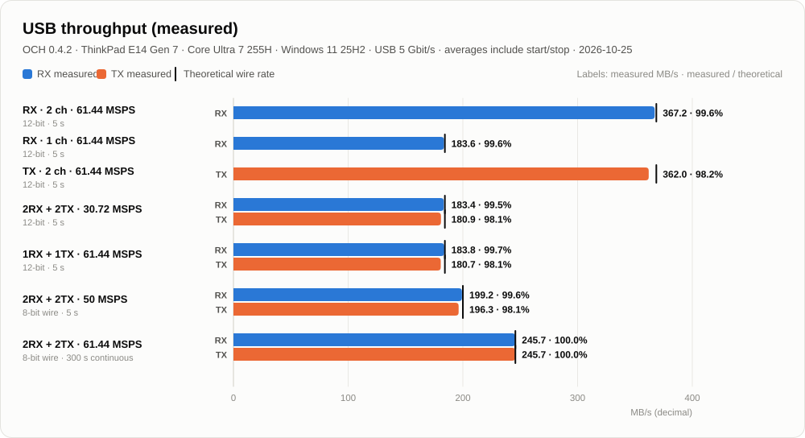
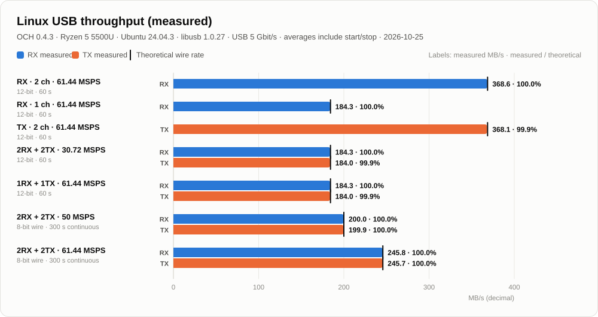

# 测试结果

本文汇总 OmniCore Host 的实测数据：USB 吞吐（USB3 / USB2，Windows / Linux）和功能测试。

> [!NOTE]
> 下列结果来自所列主机，USB 吞吐与主机控制器、端口和线材有关，更换环境后建议用 `och bench --json` 复核 `stability.pass`。测试只覆盖数据链路与控制功能，不包含 RF 功率、EVM、灵敏度等射频指标。

## 计算口径

吞吐使用 `och bench` 测量，取整个流生命周期的平均值（含启停开销），MB/s 为十进制。理论 wire 速率 = 采样率 × 通道数 × 每样本字节（12bit 为 3，8bit 为 2）。“错误”指主机丢样、USB 传输错误、设备溢出 / 欠流、事件丢失与 TX 断供的合计。

## USB 3.0 · Windows · 成帧传输（当前）

固件 v2026.11.07.1（`CH32H417_IP` 1.3，位流与 v2026.11.07 相同），OCH 0.6.1，Windows 11，USB 3.0，2026-11-07。`och bench` 零错误的最高采样率：先按 0.5 MS/s 细扫（每档 10 秒 × 2–3 次），再在最高档做 300 秒长测。USB MB/s 含每块 16 B 头，理论值不含块头。

| 配置 | 采样率 / 通道 | 测试 | RX / TX MB/s | 理论 MB/s | 错误 |
|---|---:|---|---:|---:|---:|
| 1 RX | 61.44 MSPS | 5 秒 | 184.1 / — | 184.3 | 0 |
| 2 RX | 61.44 MSPS | 60 秒 | 368.5 / — | 368.6 | 0 |
| 1 RX + 1 TX | 61.44 MSPS | 5 秒 | 183.9 / 183.8 | 184.3 | 0 |
| 1 RX + 2 TX | **58 MSPS** | 300 秒 | 174.2 / 348.3 | 174.0 / 348.0 | 0 |
| 2 RX + 1 TX | **58.5 MSPS** | 300 秒 × 2 | 351.3 / 175.7 | 351.0 / 175.5 | 0 |
| 2 RX + 2 TX · 12bit | **44 MSPS** | 300 秒 × 2 | 264.2 / 264.2 | 264.0 | 0 |
| 2 RX + 2 TX · 8bit | 61.44 MSPS | 60 秒 | 245.2 / 245.1 | 245.8 | 0 |

上限来自 FPGA 与 CH32 之间的 UHSIF 总线：RX 与 TX 共享约 533 MB/s，总流量 522–528 MB/s 时稳定。高一档的结果：2T2R 12bit 44.5 MSPS、1T2R 59 MSPS 出现 RX 溢出 / TX 欠流；2T1R 58.5 MSPS 10 秒通过，但 300 秒内有 1 次 RX 溢出和 3 次 TX 欠流。0.6.0 发布时的档位搜索（61.44 / 56 / 50 / 46 / 42）跳过了这些中间速率，因此当时记为 56 与 42 MSPS。块头开销（16 / 16384 ≈ 0.1%）对带宽没有可测影响。`tools/bench_sweep.py` 已改为细扫档位，可复现这张表。

## USB 2.0 High-Speed

USB2 下 RX 与 TX 共享 480 Mbit/s 链路预算。CLI 的 `och info --json` 中的 `usb2_reference` 与流开始时的参考值提示都来自本节的数据（`apps/och/usb2_reference.hpp`）。USB2 需要支持 USBHS 的 CH32 固件，见 [固件兼容性](firmware-compatibility.md#需要多端同时更新的功能)。


### 成帧传输复测（OCH 0.7.1，2026-11-08）

OmniCore Host 0.7.1，Zynq 固件 `SDK_CMD_1.2_20261107_SYNC`（成帧传输，板子运行 OmniCore SDR Linux 1.3.1），CH32 桥接 1.0.1（v2026.11.08），普通 USB 2.0 A 口，480 Mbit/s。下文 300 秒长测的各档位每项连续运行 30 秒：

| 配置 | USB IQ | 采样率 MSPS/通道 | RX / TX MB/s | 故障 |
|---|---:|---:|---:|---:|
| 1 RX | 12bit | 14 | 42.0 / — | 0 |
| 2 RX | 12bit | 7 | 42.0 / — | 0 |
| 1 TX | 12bit | 14 | — / 42.0 | 0 |
| 2 TX | 12bit | 6.5 | — / 39.0 | 0 |
| 1 RX + 1 TX | 12bit | 7 | 21.0 / 21.0 | 0 |
| 2 RX + 2 TX | 12bit | 3.5 | 21.0 / 21.0 | 0 |
| 2 RX + 2 TX | 8bit | 5 | 20.0 / 20.0 | 0 |

- 16 字节块头只占 0.1% 带宽，成帧传输后 USB2 档位不变。本次每项 30 秒，未重做 300 秒长测。
- RX PRBS、TX 回环自检通过；`och firmware info` 正常。
- USB-C 状态经 EP3 OUT 查询（桥接 1.0.1 的 USB2 端点）：`och info` 连续 10 次均可读，约 0.1 s。普通 USB2 A 口不声明 1.5 A / 3 A，显示 `USB default current`（寄存器 08=0x00）；同一块板接 USB3 Type-C 口时为 3000 mA（08=0x30）。

### 300 秒长测（OCH 0.4.3，2026-10-25）

| 配置 | USB IQ | 稳定采样率 MSPS/通道 | RX / TX MB/s | 启动恢复 | 1 秒后新增错误 |
|---|---:|---:|---:|---:|---:|
| 1 RX | 12bit | **14** | 41.998 / — | 2 | 0 |
| 2 RX | 12bit | **7** | 41.998 / — | 0 | 0 |
| 1 TX | 12bit | **14** | — / 41.987 | 0 | 0 |
| 2 TX | 12bit | **6.5** | — / 38.988 | 0 | 0 |
| 1 RX + 1 TX | 12bit | **7** | 20.999 / 20.993 | 1 | 0 |
| 2 RX + 2 TX | 12bit | **3.5** | 20.999 / 20.993 | 0 | 0 |
| 2 RX + 2 TX | 8bit | **5** | 19.999 / 19.994 | 1 | 0 |

每项均连续运行 300 秒；单通道使用 CH1，双通道使用 CH1 + CH2，采样率为每通道。测试主机为 ThinkPad E14 Gen 7 / Core Ultra 7 255H / Windows 11（build 26200），USB 驱动为 libusbK，固件为 `SDK_CMD_1.0_20261024_IQ8`。

### 测试条件

- `bench` 使用原生 packed12 或 signed8，默认每方向 64 MiB 缓冲、32 × 196608 B USB 请求；不包含磁盘写入或应用格式转换。
- RX/TX LO 为 1 GHz、带宽 18 MHz；TX 为 1 MHz 复正弦，幅度 0.25，衰减 60 dB。
- 以 0.5 MSPS 步进选择采样率，表中为本机完成 300 秒测试的稳定档位。
- 前 1 秒内允许 RX 溢出及完整恢复，之后零新增错误；平均吞吐至少为理论 wire 速率的 98%。
- 启动阶段的溢出必须在前 1 秒内被观察到（0.6.0 起为 `RX GAP` 事件，0.4.x 测试时为溢出通知与重同步），原始计数保留。任何阶段的 TX 欠流、主机丢样、传输错误、事件丢失、TX 断供或补零都不能计为通过。

`observed_seconds` 为 CLI 取出事件时的主机观察时间，从流启动调用返回后计时，不是硬件样本时间。RX/TX 共享设备故障计数，不能将双向计数相加。本次验证传输统计，未检查 RF 波形精度或位级连续性；换主机或 USB 拓扑需重新确认。

### 终端输出

USB2 与 USB3 的 `och info` 使用相同的设备信息布局。采样率表放在文档中，JSON 保留实测参考供脚本读取。


8bit 双通道全双工 5 MSPS 的 300 秒测试，启动恢复 1 次，后续零新增错误：


终端图由 CLI 自身的显示代码根据测量记录绘制，省略的段落以 `...` 标出。

### 复现

```powershell
och bench --rx --tx --channels 1,2 --sample-rate 3.5M --seconds 300 --attenuation 60 --fail-fast
och bench --rx --tx --channels 1,2 --iq-bits 8 --sample-rate 5M --seconds 300 --attenuation 60 --fail-fast
```

`--fail-fast` 在第 1 秒之后观察到两次相隔不超过 2 秒的 RX 溢出通知时正常停流，保存统计并返回退出码 3；恢复通知不重复计数。未触发提前停止的候选继续测满请求时长。

## 功能测试

| 项目 | 平台 | 结果 |
|---|---|---|
| 硬件时间戳（0.6.0） | Windows | `hw_timestamp_test` 6 项通过：内部 PPS 间隔恰为采样率（61.44 / 30.72 / 7.68 MSPS）、PPS 装载精确、RX 时间戳连续、定时 RX 首样点精确、定时 TX 经数据口回环延迟逐突发恒定、迟到突发不发射 |
| 数字接口自检 | Windows / Linux | RX PRBS 与 TX 数字回环通过 |
| CLI 功能检查 | Linux | 20 / 20 通过：设备信息、时钟、FIR、温度、SC16 / FC32 / packed12 采集与元数据、独占访问、Ctrl+C 退出与重开、文件保护、循环回放、非法参数 |
| 运行中改参 | Windows / Linux | RX、零 IQ TX、双向及 FIR / 时钟操作后原流恢复收发，以新 epoch 标记间断 |
| 参考与外部 LO | Windows | 参考 / LO 11 项检查与 3 次运行中切换通过；ADF4002 D5 自检闪烁序列确认 |
| RX 校正 | Windows | DC / IQ 跟踪 18 项检查与 6 次运行中切换通过 |
| PPS 监控 | Windows | 真实 PPS 下 30.72 MSPS 读数 122880000–122880001 Hz，频偏收敛至 0–0.008 ppm |
| PPS 驯服晶振 | Windows | 4 种调谐模式与 300 次参考切换握手零丢失；空闲、RX 2×2 与 IQ8 全双工各 2 分钟全程锁定，相位 ≤ 158 ns，频偏 ≤ 0.016 ppm |
| SDK 集成 | Linux | 独立 C / C++ CMake 工程链接发布包并运行；移动安装目录后仍可运行 |
| 桥接固件 USB 升级 | Windows | USB3：连续 15 次成功，约 5 秒/次；USB2（480 Mbit/s）：连续 6 次成功，约 10 秒/次（Bootloader 先尝试 USB3）。两种链路下写入中途结束进程后设备停在 Bootloader，重新升级恢复；升级后 SDK 控制与 IQ 收发正常 |

## 历史测量：0.4.x 起始头模式

以下为 0.4.x（16 KiB 递增起始头、固件 `SDK_CMD_1.0_20261024_IQ8`）时的测量。成帧传输的块头只占约 0.1% 带宽，Linux USB3 尚未在成帧传输下复测。

#### 测试环境

| | Windows | Linux |
|---|---|---|
| 主机 | ThinkPad E14 Gen 7，Core Ultra 7 255H，32 GB | AMD Ryzen 5 5500U，6 核 12 线程 |
| 系统 | Windows 11 25H2（build 26200） | Ubuntu 24.04.3，Linux 7.0 x86_64 |
| USB 驱动 | libusbK 3.1.0.0 | libusb 1.0.27（usbfs） |
| 编译器 | MinGW-w64 GCC，Release | GCC 13.3，Release |
| 板卡固件 | `SDK_CMD_1.0_20261024_IQ8` | `SDK_CMD_1.0_20261024_IQ8` |
| 缓冲配置 | 每方向 32 × 196608 B USB 请求，64 MiB 环形缓冲 | 同左，`usbfs_memory_mb=16`（系统默认） |

#### USB 3.0 · Windows



| 配置 | USB IQ | 时长 | RX / TX MB/s | 理论 MB/s | 比例 RX / TX | 错误 |
|---|---:|---:|---:|---:|---:|---:|
| 2 RX · 61.44 MSPS | 12bit | 5 秒 | 367.2 / — | 368.6 | 99.6% / — | 0 |
| 1 RX · 61.44 MSPS | 12bit | 5 秒 | 183.6 / — | 184.3 | 99.6% / — | 0 |
| 2 TX · 61.44 MSPS | 12bit | 5 秒 | — / 362.0 | 368.6 | — / 98.2% | 0 |
| 2 RX + 2 TX · 30.72 MSPS | 12bit | 5 秒 | 183.4 / 180.9 | 184.3 | 99.5% / 98.1% | 0 |
| 1 RX + 1 TX · 61.44 MSPS | 12bit | 5 秒 | 183.8 / 180.7 | 184.3 | 99.7% / 98.1% | 0 |
| 2 RX + 2 TX · 50 MSPS | 8bit | 5 秒 | 199.2 / 196.3 | 200.0 | 99.6% / 98.1% | 0 |
| 2 RX + 2 TX · 61.44 MSPS | 8bit | 300 秒 | 245.7 / 245.7 | 245.8 | 100.0% / 100.0% | 0 |

#### USB 3.0 · Linux



| 配置 | USB IQ | 时长 | RX / TX MB/s | 理论 MB/s | 比例 RX / TX | 错误 |
|---|---:|---:|---:|---:|---:|---:|
| 2 RX · 61.44 MSPS | 12bit | 60 秒 | 368.6 / — | 368.6 | 99.98% / — | 0 |
| 1 RX · 61.44 MSPS | 12bit | 60 秒 | 184.3 / — | 184.3 | 99.98% / — | 0 |
| 2 TX · 61.44 MSPS | 12bit | 60 秒 | — / 368.1 | 368.6 | — / 99.85% | 0 |
| 2 RX + 2 TX · 30.72 MSPS | 12bit | 60 秒 | 184.3 / 184.0 | 184.3 | 99.98% / 99.85% | 0 |
| 1 RX + 1 TX · 61.44 MSPS | 12bit | 60 秒 | 184.3 / 184.0 | 184.3 | 99.98% / 99.85% | 0 |
| 2 RX + 2 TX · 50 MSPS | 8bit | 300 秒 | 200.0 / 199.9 | 200.0 | 100.0% / 99.97% | 0 |
| 2 RX + 2 TX · 61.44 MSPS | 8bit | 300 秒 | 245.8 / 245.7 | 245.8 | 100.0% / 99.97% | 0 |

Linux 测试的 TX 发送零 IQ、衰减 89.75 dB；所有档位 `stability.pass=true`，未调整内核 USB 内存配额、实时调度或 CPU 电源策略。
