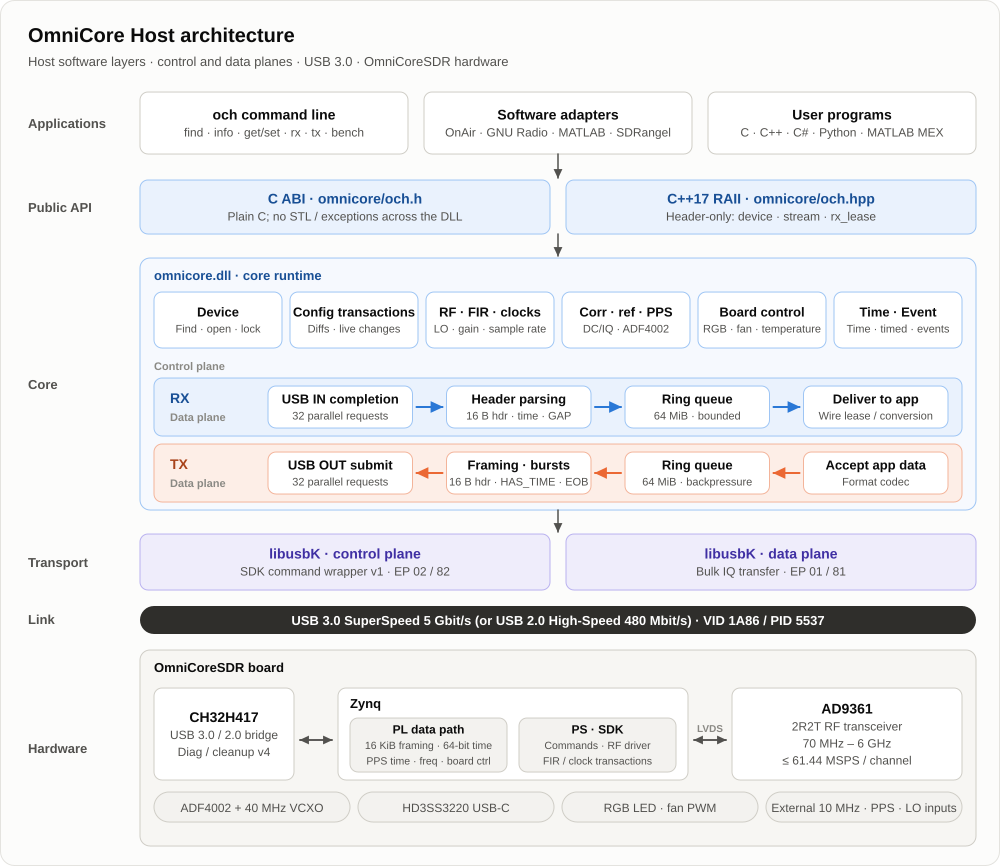

---
hide:
  - navigation
---

# OmniCore Host

OmniCore Host (OCH) is the host-side software for **OmniCoreSDR** (AD9361 + Zynq + CH32H417 USB bridge): a C++17 runtime library, the `och` command-line tool, and a public C/C++ SDK, plus a SoapySDR plugin and a MATLAB toolbox. It handles device discovery, RF control, continuous IQ receive and transmit, hardware timestamps, and throughput testing.

| Version | Platforms | Interface | License |
|---|---|---|---|
| **0.8.0** (C ABI 1) | Windows 10/11 x64 · Linux x86_64 · macOS 12+ (universal) | Plain C ABI + header-only C++ RAII wrapper | GPL-3.0-or-later |

[Download a release](https://github.com/Liren66/OmniCore-SDR-Host/releases){ .md-button .md-button--primary }
[Installation](install.md){ .md-button }
[Source on GitHub](https://github.com/Liren66/OmniCore-SDR-Host){ .md-button }



!!! warning "Firmware"
    OCH 0.6.0 and later need Zynq firmware [v2026.11.07](https://github.com/Liren66/OmniCore-SDR-Firmware/releases/tag/v2026.11.07) or later (framed USB transport); [v2026.11.08](https://github.com/Liren66/OmniCore-SDR-Firmware/releases/tag/v2026.11.08) is recommended. See [Firmware Compatibility](firmware-compatibility.md).

## Where to start

<div class="grid cards" markdown>

-   **Install and connect**

    ---

    Install on Windows, Linux, or macOS, then check the device with `och find` and `och info`.

    [Installation](install.md) · [CLI Reference](cli.md) · [Troubleshooting](troubleshooting.md)

-   **Write code**

    ---

    Use the C ABI or the C++ wrapper: devices, streams, runtime reconfiguration, and metadata.

    [API Reference](api.md) · [Architecture](architecture.md)

-   **GNU Radio, SDR++, Python**

    ---

    The SoapySDR plugin (`driver=omnicore`) works with any SoapySDR application.

    [SoapySDR Plugin](soapy.md)

-   **MATLAB and Simulink**

    ---

    Capture, transmit, timed RX/TX, and full duplex with no other toolboxes required.

    [MATLAB Toolbox](matlab.md)

-   **Hardware time**

    ---

    64-bit sample time, PPS alignment, timed RX, timed TX bursts, and multi-board sync.

    [Hardware Timestamps](timestamps.md) · [Multi-Board Sync](multi-board-sync.md)

-   **Performance**

    ---

    Measured USB3 / USB2 throughput on Windows and Linux, and how to reproduce it.

    [Benchmarks](benchmarks.md)

</div>

## Quick look

```bash
och find                      # enumerate devices
och info                      # identity, firmware, USB link, RF capabilities, power
och rx --file rx.sc16 --channels 1,2 --lo-frequency 1G --sample-rate 15.36M --seconds 5
och bench --rx --tx --channels 1,2 --sample-rate 30.72M --seconds 10
```

```cpp
#include <omnicore/och.hpp>

och::device dev;                         // the only device; pass a serial number when there are several
auto cfg = och::default_config();
cfg.sample_rate = 30720000;
cfg.rx_mask = 3;                         // RX1 + RX2
dev.configure(cfg);

och::stream rx(dev, och::stream_args(OCH_RX));
rx.start();
```
