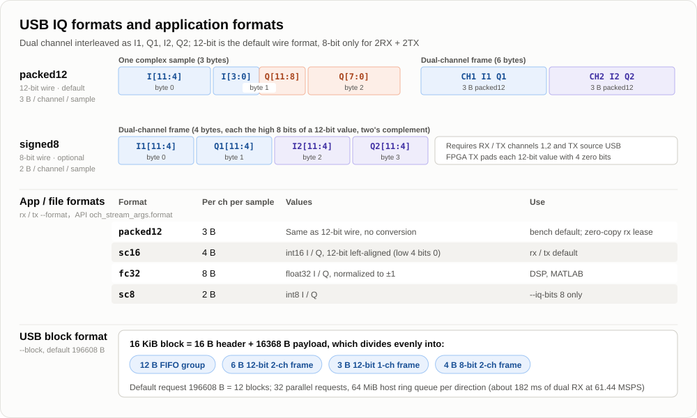

# Optional signed8 USB IQ for 2TX2RX

8-bit USB IQ has been available since OCH 0.4.0. 12-bit remains the default and ABI 1 is unchanged. The firmware's `system_info?` must report both `iq_format=1` and `iq8_2t2r=1`; the currently required FPGA `CH32H417_IP` 1.3 already includes the 8-bit path.

## Wire format and values



12-bit uses 3 bytes of packed12 per complex sample per channel. 8-bit is selected only when both the RX and TX masks are 3 and the TX source is USB; each time frame is the four bytes `I1[11:4],Q1[11:4],I2[11:4],Q2[11:4]`, all two's-complement signed8. When restoring each 12-bit value, the FPGA TX path fills the low 4 bits with zeros. Channel order is unchanged; the 16368 B payload of each 16 KiB block holds exactly 4092 8-bit time frames, so a block always contains a whole number of samples.

| Application format | Bytes per complex sample per channel | 8-bit RX output | 8-bit TX input handling |
|---|---:|---|---|
| packed12 | 3 | signed8 extended to 12 bits in the high bits, low 4 bits zero | Drop the low 4 bits of each 12-bit value |
| sc16 | 4 | signed8 × 256, left-aligned | Take the high 8 bits of the signed16 |
| fc32 | 8 | signed8 ÷ 128 | Use the existing 12-bit quantization, then drop the low 4 bits |
| sc8 | 2 | signed8 I/Q as is | As is |

FC32 keeps the original rules: round half away from zero, saturate to -2048..2047, NaN becomes zero, infinities saturate. Reducing to 8 bits deletes the low 4 bits of the two's-complement value; it is not replaced by a separate 8-bit rounding rule. For example, 12-bit -1 becomes signed8 -1, which the FPGA restores to 12-bit -16.

## Configuration and compatibility

`och_config.usb_iq_bits` occupies the former `reserved[0]` at offset 76 with a struct size of 104 bytes; the offsets of all existing members are unchanged. 0 or 12 selects the default legacy format; 8 requires both channel masks to be 3. `och_default_config` sets it to 0, so the zeroed reserved slot of older applications keeps the original behavior. `OCH_SC8=3` is new and does not change existing enum values; SC8 streams can only be created with the 8-bit wire format.

The SDK `system_info?` must contain `iq_format=1`, and 8-bit additionally requires the PL capability `iq8_2t2r=1`. Older SDKs without the extension can still be configured for 12-bit, and a newer host never sends them the new commands. Each configuration transaction on a new host first stops everything and cleans up; when the extension is supported it first restores 12-bit, then applies channels/sources, and finally selects 8-bit if requested, so 8-bit left over from a previous handle is never inherited. After writing the format, the query strictly checks requested/applied, busy/error, verified, and scope.

Changing the wire bit width while any stream object exists returns BUSY; stop/destroy the streams in both directions first, then configure/create. Ordinary reconfiguration of frequency, gain, clocks, and so on keeps the wire format and still uses the existing pause, cleanup, zero prefill, and restart mechanism. RX and TX may be started and stopped separately in the original order; the constraint is on the two channel masks, not on both USB enables being 1 at every instant.

TX start with IQ8 uses a threshold of 1536 raw FIFO groups (same as the SDK); 12-bit keeps the original 2700 for dual-channel / 1350 for single-channel. With IQ8, the first 16 KiB packet fills about 2046 main FIFO groups, which is enough to start; waiting for the old 2700 would stall because the FIFO has no room to accept the second packet. The host submits large USB transfers asynchronously and polls the hardware level, rather than waiting for a whole USB transfer to complete before enabling TX_RUN.

`och_rx_acquire` always returns the current wire format, independent of the application `format`. The dual-channel sample count is `bytes / 4` for 8-bit and `bytes / 6` for 12-bit. `och_recv` converts to the selected application format. All sample indices, drops, TX padding, and prefill are counted in time samples per channel; USB/ring bytes are counted in the current wire format.

## CLI and examples

```powershell
och get system.info
och get usb.iq-bits
och bench --rx --tx --channels 1,2 --iq-bits 8 --sample-rate 30.72M --seconds 10 --attenuation 89.75 --amplitude 0 --json
och bench --rx --tx --channels 1,2 --iq-bits 12 --sample-rate 30.72M --seconds 10 --attenuation 89.75 --amplitude 0 --json
```

bench automatically picks sc8 for 8-bit and packed12 for 12-bit, and only supports these two native application formats. SC16/FC32 conversion has to be tested through the API's `och_send` / `och_recv`; bench or zero-copy RX must not be passed off as a conversion test. The commands above transmit zero IQ with 89.75 dB TX attenuation and do not read or write IQ files.

At 31.25 MSPS, 8-bit dual-channel is 125 MB/s per direction; at 30.72 MSPS it is 122.88 MB/s (245.76 MB/s both directions); at 61.44 MSPS it is 245.76 MB/s per direction (491.52 MB/s both directions). The 16 B header per block (about 0.1%) and USB protocol overhead come on top. The CLI JSON `usb_MBps` is the stream's cumulative USB bytes divided by `elapsed_seconds`, including start/stop overhead; it is not the rate over a separate steady-state window.

`examples/duplex_iq8.cpp` shows dual-channel SC8 receive and dual-channel zero-IQ transmit with a separate TX producer. Changing the application args.format lets you use SC16/FC32/packed12; buffers are sized for the application format.

When using the SoapySDR plugin, put `iq_bits=8` in the device arguments (e.g. `driver=omnicore,iq_bits=8`). Both channels must then be enabled; the native format is CS8, and CS16 / CF32 can also be used. Full duplex additionally needs `rx_mask=3,tx_mask=3`. For the acceptance results of 2T2R 61.44 MSPS in GNU Radio, see [SoapySDR Plugin](soapy.md).

The SDK control commands are `iq_format?`, `iq_format=8`, and `iq_format=12`; the canonical CLI name is `usb.iq-bits`. The CH32 data/control firmware passes data through transparently. A query on a new SDK includes `iq_format=8 requested=8 applied=8 supported=12,8 cfg_busy=0 cfg_error=0 verified=1 scope=2tx2rx`; further diagnostic fields may be appended.

## Measured performance

| Host | Configuration | Duration | RX / TX MB/s | Overflow / underflow / host drops |
|---|---|---:|---:|---|
| Windows 11, USB3 5 Gbit/s | 8-bit 2RX + 2TX, 61.44 MSPS | 300 s | 245.7 / 245.7 | 0 / 0 / 0 |
| Ubuntu 24.04, USB3 5 Gbit/s | 8-bit 2RX + 2TX, 61.44 MSPS | 300 s | 245.8 / 245.7 | 0 / 0 / 0 |
| Windows 11, USB3 5 Gbit/s | 8-bit 2RX + 2TX, 50 MSPS | 300 s | 200.0 / 200.0 | 0 / 0 / 0 |

The theoretical wire rate is 245.76 MB/s (61.44 MSPS × 2 channels × 2 bytes). Results depend on the host, USB controller, and port, and do not guarantee zero drops over long periods on any host; the 50 MSPS setting leaves throughput headroom.
