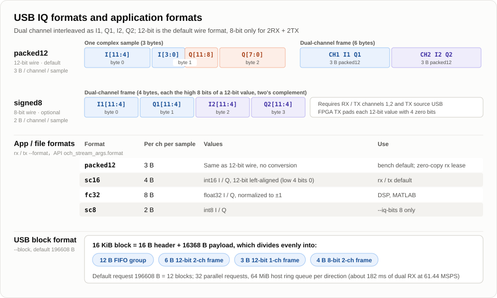

# Device Control and Data Protocol Reference

This page documents the device protocol used by OmniCore Host, as a reference for maintaining the control backend and developing adapters. Ordinary applications should call the [C/C++ API](api.md), and users should prefer the [canonical commands](commands.md) and the [FIR/clock commands](fir.md). This project and the installer contain no copy of the ZYNQ SDK source, ELF, BOOT.bin, or FPGA bitstream, and never download board firmware automatically.

## Capabilities and endpoints

Whether an extension exists cannot be judged from the firmware name alone. Confirm `host_protocol=1` with `host_protocol?`, and `transport=framed16k` with `system_info?` (required since 0.6.0; the older firmware's `header_on=rx_start_and_overflow_recovery` is no longer accepted); the hardware time API also requires `hw_time=1`, and FIR and safe clock configuration require `fir_upload=1` and `clock_config=1` respectively.

The RX correction extension requires `system_info?` to contain `rx_correction=1`: `rx_dc_correction?` / `rx_dc_correction=0|1` controls the AD9361 RF and baseband DC tracking together, and `rx_iq_correction?` / `rx_iq_correction=0|1` controls RX quadrature tracking. The replies contain a scalar of the same name with value 0/1, optionally followed by status fields. The SDK setters require streams to be stopped, and OCH's C/C++ interface coordinates the existing session; for the semantics see [API: RX DC and IQ correction](api.md#rx-dc-and-iq-correction).

| USB endpoint | Purpose |
|---|---|
| 0x01 OUT | TX framed blocks: 16 B header (HAS_TIME/SOB/EOB, sequence number, sample time) + packed12 or 2TX2RX signed8 IQ |
| 0x81 IN | RX framed blocks: 16 B header (flags, sequence number, valid frame count, first-sample time) + packed12/signed8 IQ |
| 0x02 OUT | CH32/ZYNQ control command text |
| 0x82 IN | Command responses and asynchronous EVTs |
| 0x83 IN | Optional existing CH32 debug log; the power query reads the boot snapshot |

USB request completion boundaries are not text line or IQ session boundaries: a line may span requests, and one request may carry several lines. For the non-real-time limitations of the EP83 information, see [Power information](cli.md#usb-c-power-information).

The 8-bit extension uses `iq_format?` / `iq_format=12|8`, with the capabilities `iq_format=1 iq8_2t2r=1`. 12-bit is the default, and 8-bit can only be selected when both the RX and TX masks are 3. The high 8 bits of the original 12-bit values are sent in I1,Q1,I2,Q2 order, and TX restores the low 4 bits as zeros; each time frame is 4 bytes. An SDK internal block may contain two time frames, so the internal block width must not be used in place of the application frame width. Switching formats requires both directions to be fully stopped; in normal operation they can be started and stopped separately. The CH32 firmware is unchanged. See [8-bit protocol and compatibility](iq8.md).

## Command wrapper v1

The host sends one ASCII command terminated by LF; the console also accepts CR/CRLF, and PL UART output uses CRLF. An input line including the wrapper and excluding the newline is at most 127 characters; the command body allows printable ASCII characters and horizontal TAB, and forbids NUL, embedded newlines, non-ASCII bytes, and nested wrappers.

~~~text
@<id> <original command>
~~~

id is a decimal uint32 in 1..4294967295, without sign or radix prefix; leading zeros are allowed, and responses use canonical decimal. At least one space or TAB follows the id, the command body cannot be empty, and its first non-whitespace character cannot be `@`.

~~~text
@42 rx_samp_freq?
RSP id=42 begin
rx_samp_freq=30720000
RSP id=42 end result=0
~~~

Each device may have only one outstanding command. Only begin/end with the matching id complete that transaction; other ids cannot complete it, and a matching end without a begin is a protocol error. Duplicate records must not change a completed result. The response body keeps the original SDK format; the host normalizes response lines to LF, and both the accumulated response and an unterminated control line are limited to 32768 bytes.

`result` is the signed return value of the original callback; usually 0 means dispatch succeeded and -1 means failure. Some older callbacks print an error in the body yet still return 0, so the host also treats existing error bodies such as `ERR`, `Error:`, and `Invalid` as failures. A wrapper with a syntax error is not dispatched and may only output `Invalid host envelope: ...` without an RSP; the host must validate input before sending.

Success must not be judged by "no new bytes for some milliseconds". A complete transaction end record must be received, otherwise a timeout/failure is reported. After a timeout, the control session is considered unusable; wait for the device to finish responding, then close and reopen, so a late response is never taken as the reply to the next command.

## Asynchronous events

Lines starting with `EVT ` are asynchronous events and may arrive before a command, in the middle of a response, or after it. The control thread puts them into a bounded event queue; they are not appended to the response body and never complete a command. `event_drops` may increase if the queue is not consumed in time.

Timed FPGA events carry the sample time and are reported by the SDK in the format below; OCH maps them to the corresponding `och_event.type` and fills in `hw_time`, `code`, and `block`:

~~~text
EVT tseq=<n> type=<name> src=fpga_time code=<n> block=<seq> time=<ticks> lost_before=<0|1>
EVT tseq=<n> type=time_invalidated src=sdk old_rate=<Hz> new_rate=<Hz>
~~~

| SDK type | code | OCH event |
|---|---|---|
| `tx_burst_ack` | 0x01 | `OCH_EVENT_TX_BURST_ACK` |
| `tx_underflow` | 0x02 | `OCH_EVENT_TX_UNDERFLOW` |
| `tx_late` | 0x03 | `OCH_EVENT_TX_LATE` |
| `tx_seq_error` / `tx_header_error` | 0x04 / 0x05 | `OCH_EVENT_TX_ERROR` |
| `rx_overflow_gap` | 0x10 | `OCH_EVENT_RX_GAP` |
| `rx_late_command` / `rx_command_ignored` | 0x11 / 0x12 | `OCH_EVENT_RX_LATE` |
| `time_invalidated` | — | `OCH_EVENT_TIME_INVALIDATED` |

## Framed block format

Each 16384 B block on the IQ endpoints = 16 B header + 16368 B payload. The block header is 4 little-endian u32 words:

~~~text
h0 = 0x4F43_0000 | flags<<8 | check     byte order: check, flags, 'C', 'O'
h1 = seq<<16 | valid                    valid = number of valid frames in this block, zero-padded after
h2 = time[31:0], h3 = time[63:32]       time of the first sample in this block, 1 tick = 1 sample
check = XOR of bytes 1..15
~~~

| Direction | flags |
|---|---|
| RX | bit0 TIME_VALID, bit1 SOB, bit2 GAP (samples were dropped before this block), bit3 EOB, bit4 LATE, bit5 PAD |
| TX | bit0 HAS_TIME, bit1 SOB, bit3 EOB; blocks with `valid=0` are discarded |

| Wire format | Per frame | Frames per block |
|---|---:|---:|
| 12-bit single-channel | 3 B | 5456 |
| 12-bit dual-channel | 6 B | 2728 |
| 8-bit dual-channel | 4 B | 4092 |

USB request completion boundaries are always a whole multiple of 16 KiB, so block headers are always aligned within requests; the core still parses as a byte stream and searches for a block header again when a checksum fails.

Time-related SDK commands (`time_now?/=`, `time_next_pps=`, `time_last_pps?`, `time_source=`, `time_status?`, `rx_timed=`, `rx_stream=`, `rx_stream_stop!`) are called by OCH's time API; see [Hardware Timestamps](timestamps.md) and `docs/sdk-commands.md` in the Firmware repository.

UART receive in the existing console has a limited software buffer. On error/overflow it discards queued and partially parsed commands, resynchronizes at the next line boundary, and may output:

~~~text
Error: UART receive overflow/error; queued and partial commands discarded.
~~~

Unlimited pipelined sending is not supported; the host must still wait for each RSP to complete.

## Control UART

The control link between the Zynq PL UART16550 (`CONSOLE_BAUD_RATE` in the SDK's `console.h`) and the CH32 USART1 (`UART1_BRIDGE_BAUD` in the UHSIF project's `Common/usbss_uart1_bridge.h`) was raised from 115200 to **3.125 MBd**. Both sides must match and must be updated together: with one side new and the other old, `och find` still sees the device, but `och info` fails because `host_protocol?` times out.

| Side | Clock | Baud rate formula | Limit |
|---|---|---|---|
| Zynq AXI UART16550 | 100 MHz (`XPAR_AXI_UART16550_0_CLOCK_FREQ_HZ`) | 100 MHz / (16 × integer divisor) | 6.25 MBd |
| CH32H417 USART1 | HCLK 100 MHz (SYSCLK 400 MHz / 4) | HCLK / (16 × USARTDIV), USARTDIV with 4 fractional bits | 6.25 MBd (the 9 Mbps rated in the manual needs a higher HCLK) |

Because the 16550 only supports integer divisors, the only rates both sides can hit exactly are 6.25 MBd / N: 6.25M, 3.125M, 2.083M, 1.5625M, and so on; the SDK enforces this with a compile-time check. 3.125 MBd (N=2) was chosen over 6.25 MBd because the Zynq console receives by polling: the 16-byte FIFO fills in about 51 µs at 3.125 MBd but only about 26 µs at 6.25 MBd, while doubling again would only save about another 0.1 ms per command. If the FIFO overflows, the SDK replies `Error: UART receive overflow` rather than silently dropping the command. The CH32's 8 KiB receive ring buffer must be serviced about every 26 ms at 3.125 MBd, which the main loop satisfies.

### Measurements

USB3, with a dual-channel 30.72 MSPS RX stream running:

| Item | 115200 | 3.125 MBd |
|---|---|---|
| Command round trip (`rx_lo_freq?`) | 7.2 ms | 0.6 ms |
| `system_info?` (916 B) | 81 ms | 3.4 ms |
| `rx_rssi?` | — | 1.1 ms |
| `rx_lo_freq=` (same band) | 11.2 ms | 3.8 ms |
| `och_configure` retune while streaming | 11.3 ms | 4.0 ms |
| Retune across gain tables | 32.7 ms | 25.4 ms (mostly SPI writes of the gain table) |

Full-speed dual channel: RX on 2 channels at 61.44 MSPS (12-bit, 368.6 MB/s) for 60 s, with RSSI enabled and read every 10 ms, 3,538 reads in total, all valid, average 1.26 ms, maximum 3.15 ms; throughput 61.44 MS/s per channel with no discontinuities, no device or host overflows, and no dropped samples, exactly the same as without reading RSSI.

Stress test: 4,530 consecutive commands (including the 9.7 KB `help?` reply) with no errors and no UART overflows; long replies run at about 0.3 MB/s, the line-rate ceiling; RX stayed at 30.72 MS/s throughout.

## CH32 diagnostics and cross-session cleanup

The host uses the vendor IN requests of the existing diagnostic protocol v4: `bmRequestType=0xC0`, `bRequest=0xD0`. `wValue=0` reads diagnostics, where the first two uint32 are the magic `0x53444731` and version 4; `wValue=2` requests stream buffer cleanup.

Cleanup only runs when both RX and TX are stopped, and drains any residual RX data. So to restart the same direction after a stop, you first need to stop the other direction; the core will not flush data the other direction is using just to reopen one side. This capability is an existing protocol on the board and does not mean the host installer updates the CH32.

## FIR chunked transactions

The following commands are still sent inside the `@id` wrapper; extension fields are all decimal integers, with no floating point, exponents, or hexadecimal. The host must manage the whole transaction serially and must not let different callers interleave uploads.

~~~text
rx_fir_begin=<token>,<taps>,<factor>,<gain_dB>
tx_fir_begin=<token>,<taps>,<factor>,<gain_dB>
fir_data=<token>,<offset>,<c0>[,<c1>...<c7>]
fir_commit=<token>,<enable>,<crc32>
fir_abort=<token>
~~~

token is a non-zero uint32, and RX/TX share one staging slot. When idle, a valid begin replaces any leftover staged state and the old token becomes invalid. begin/data only modify RAM; coefficients are uploaded contiguously starting from offset=0, with 1..8 signed16 integers in -32768..32767 per line. An invalid chunk does not change state. commit requires all taps to have been received, a matching token, enable of 0/1, and a matching CRC32.

The CRC is the reflected IEEE CRC32 with polynomial `0xEDB88320`, and an initial value and final XOR of `0xFFFFFFFF`. Only the declared coefficients are serialized, each int16 as two's complement, little-endian with the low byte first, without metadata or padding; the CRC of the ASCII bytes `12345678` is `0x9AE0DAAF`.

taps is 16..128 and a multiple of 16, and factor is 1/2/4; TX factor=1 allows at most 64 taps. RX gain is -12/-6/0/6 dB and TX gain is -6/0 dB. Both physical channels of the same direction use the same configuration, and the actual tap limit is also affected by the clock budget. Invalid combinations must fail; the sample rate must not be silently changed to 1/1.5 MSPS.

A successful commit consumes the token; a rejected or failed FIR commit keeps the token, allowing an explicit retry/abort. An abort after a successful commit gets a token mismatch, and that cleanup error must not replace the original error.

### FIR query and enable

~~~text
rx_fir_config?
rx_fir_config=1 taps=32 factor=2 gain_dB=0 enabled=1 crc32=<uint> verified=1 source=verified_snapshot
rx_fir_read=<offset>,<count>
rx_fir_read=<offset> <c0> ...
fir_enable=<rx_enable>,<tx_enable>
~~~

TX uses the corresponding `tx_` prefix. The count of read is 1..8 and cannot exceed the configured taps; it returns the RAM snapshot that passed SPI verification, and does not re-read SPI on each query. commit first reads back the coefficients of both physical channels and checks taps, gain, enable, and clocks.

config=0 means the built-in example preset, and config=1 means a custom upload. The old `rx_fir_config=0` / `tx_fir_config=0` restore the example coefficients and turn off the FIR for that direction, keeping the other direction and the shared sample rate. `rx_fir_en=` / `tx_fir_en=` change enable through the same checked transaction, while `fir_enable=` sets both sides in one transaction.

## Clock transactions

~~~text
clock_sample_rate=<Hz>
clock_begin=<token>
clock_rx=<token>,<BBPLL>,<ADC>,<R2>,<R1>,<CLKRF>,<RX_SAMPLE>
clock_tx=<token>,<BBPLL>,<DAC>,<T2>,<T1>,<CLKTF>,<TX_SAMPLE>
clock_commit=<token>
clock_abort=<token>
clock_chain?
clock_chain ref=<Hz> unit=Hz rx=<six CSV rates> tx=<six CSV rates>
~~~

`clock_sample_rate` computes a valid shared chain and never falls back to a lower rate. The clock staging slot for a complete chain is separate from the FIR slot, and begin replaces the old token; commit requires both directions to have been submitted with the same token, and consumes the token before applying. All frequencies are positive uint32 Hz, the BBPLL and final sample rate of RX/TX must be the same, and Fs must not exceed 61.44 MHz.

The device checks BBPLL 715..1430 MHz, ADC 25..640 MHz, DAC no higher than 320 MHz, the available integer divider/half-band factors, the FIR factor, and the computation budget for the effective taps. The AD9361 reference clock is still the on-board 40 MHz; disciplining it to an external 10 MHz can be selected with the separate ADF4002 commands. For PPS frequency monitoring see [PPS protocol fields](pps.md); for loading hardware time on PPS see [Hardware Timestamps](timestamps.md).

## Apply, verification, and recovery

Hardware changes require both USB directions and TX output to be stopped; otherwise busy is returned, and streams still running are not stopped implicitly. Before writing, the SDK saves the FIR, enable state, clocks, and bandwidth of both directions, validates the proposed combination, programs it, reads back both channels over SPI, and then checks clocks/bandwidth plus RX PRBS and TX digital loopback. These checks prove the integrity of the digital configuration; they are not measurements of passband/stopband, group delay, or analog RF performance.

On failure it attempts to check and restore the original state:

~~~text
ERR fir_or_clock_apply ... rollback=verified applied=restored ...
ERR fir_or_clock_apply ... rollback=failed applied=unknown ...
~~~

In the latter case the RF/digital state is marked invalid, and streaming is forbidden until `rf_reinit!` succeeds. The host invalidates its configuration cache after any failed hardware change, and the application should confirm recovery and reconfigure. `rf_reinit!` can reload the current custom FIR/clocks kept in RAM; a power cycle or reloading the ELF loses the custom state in RAM.

Neither building the host from source nor installing it compiles, downloads, or writes the SDK, CH32, FPGA, BOOT.bin, or boot flash. The board firmware lives in the [OmniCore-SDR-Firmware](https://github.com/Liren66/OmniCore-SDR-Firmware) repository and must be built and released following its own procedure.
