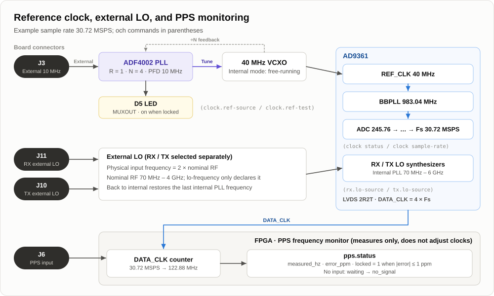

# ADF4002 Reference and External LO

The ADF4002 on schematic `AD9361_MIX(3).pdf` uses an external 10 MHz as its reference to steer the on-board 40 MHz oscillator. The AD9361 still receives **40 MHz**, and `clock.chain` / `och_get_clock().reference_hz` still report 40000000. Selecting the external reference does not change the AD9361 clock chain to 10 MHz.

## Commands

| OCH command | SDK command | Meaning |
|---|---|---|
| `och get clock.ref-source` | `clock_ref_source?` | 0 = internal free-running, 1 = disciplined by the ADF4002 from an external 10 MHz |
| `och set clock.ref-source internal` | `clock_ref_source=0` | Default; lock indicator off, charge pump three-state |
| `och set clock.ref-source external` | `clock_ref_source=1` | Enables the external reference loop after the CH32 confirms PA4 is high-impedance (the SDK first replies `pending=1`, and OCH polls `vcxo_status?`); D5 is driven by the ADF4002 digital lock output |
| `och get clock.ref-status` | `adf4002_status?` | Configuration, GPIO read-back; frequency LOCK from a valid PPS |
| `och action clock.ref-test` | `adf4002_self_test!` | Charge pump three-state, D5 blinks three times, then the reference selection from before the test is restored |
| `och get rx.lo-source` | `rx_lo_source?` | RX internal/external LO and nominal RF frequency |
| `och set rx.lo-source external` | `rx_lo_source=1` | Use the RX external LO input |
| `och set rx.lo-source internal` | `rx_lo_source=0` | Restore the RX internal PLL |
| `och get tx.lo-source` | `tx_lo_source?` | TX internal/external LO and nominal RF frequency |
| `och set tx.lo-source external` | `tx_lo_source=1` | Use the TX external LO input |
| `och set tx.lo-source internal` | `tx_lo_source=0` | Restore the TX internal PLL |

`internal/external` also accept `0/1`. The SDK capabilities are `adf4002=1`, `ref_source=1`, and `external_lo=1`. The CH32H417 firmware and the USB transport format are unchanged.

## Communication check without 10 MHz connected

Just run `och action clock.ref-test` and watch whether D5 blinks three times; no external 10 MHz is needed. The original source selection is restored after the test, and in the default internal state the LED goes back off. The automatic result `gpio_verified=1` only means the processor's GPIO pad read-back matches the output; it does not prove the ADF4002 received the command.

On the schematic, the ADF4002 MUXOUT **only connects to D5 and does not return to any PS/PL input pin**, and the serial interface has no register read-back. The raw SDK protocol therefore reports `chip_verified=0`, `lock_known=0 locked=-1`, and `led_known=0 led_on=-1`. Since OCH 0.3.4 the display layer hides these unknown lock/LED values, and `och_reference_status.lock_known/locked` instead carry a PPS frequency-tolerance flag: a valid measurement within ±1 ppm is locked, outside is unlocked; it is hidden when PPS is off, absent, or invalid. An unsupported or failed PPS query does not block setting the external reference either. See [PPS LOCK semantics](pps.md#lock-display-in-och). `led_mode=1` means it is configured as a lock indicator; it must not be read as the LED being on or the loop being locked. `visual_confirmation_required=1` means someone needs to watch D5 blink to supply the evidence of chip communication.

`source` is a confirmed configuration state only when `source_known=1`. After a driver fault it may keep `source=0 initialized=1` while also returning `source_known=0 gpio_verified=0 last_error=-5`; that 0 is a cached value and must not be taken to mean the internal reference was safely restored. The typed getter keeps these diagnostic fields. In this state, explicitly running `och set clock.ref-source internal` reprograms the ADF4002 rather than being treated as a no-op; a same-value no-op is allowed only when the source is known, the GPIO check passed, and there is no error. In an unknown/failed state, the self-test refuses to run and asks you to restore the internal reference first.

If the SDK has also marked RF as not ready, after the reference is restored you need to explicitly run `och action rf.reinit` while no stream objects exist, then `configure` again and recreate the streams; the reference setter never implicitly reinitializes RF or starts transmitting.

Once an external 10 MHz is connected you can select `external`. If the ADF4002 locks, MUXOUT lights D5 directly; the processor does not learn the lock state from it. Without an external 10 MHz, do not treat a successful setting or the GPIO read-back as a substitute for verifying lock.

A successful source setting does not wait for the lock state, which cannot be read back. After connecting the external reference, watch D5 to confirm lock before starting captures that depend on stability.

## External LO and frequency semantics

RX and TX are selected independently; both default to `internal`. The AD9361's external LO physical input frequency is **2×** the nominal RF frequency; the supported nominal RF range is 70 MHz..4 GHz. The internal PLL keeps its original range of 70 MHz..6 GHz. Input levels and connections must follow the board circuit and the AD9361 specifications.

Switching to external keeps the current nominal RF frequency. In the external state, `rx.lo-frequency` / `tx.lo-frequency` only declare the nominal RF frequency the external signal corresponds to, for the driver's use; software cannot tune the external signal source. Returning to internal restores the last internal PLL frequency for that direction; the OCH typed setter reads that frequency back and syncs the `och_config` cache, so a later `configure` is not misjudged as a no-op because of a stale cache. When restoring the RX frequency crosses into a different gain table, the SDK keeps the manual gain and clamps it to the target band, and OCH reads back both gains to sync the cache.

`configure` keeps the independent LO source selection and does not implicitly switch back to internal. With an external source selected, frequencies above 4 GHz are rejected before any existing streams are paused. A stream configuration started from a new CLI invocation still uses that command's default or explicit nominal frequency, so when using an external LO, pass `--rx-lo-frequency` / `--tx-lo-frequency` values that match the signal source. Without an external LO connected, you can check the source selection register, but this does not prove RF RX/TX works, that an external signal is present, or that calibrations depending on it succeeded.

## Programming interface and switching boundaries

New standalone ABI 1 structs were added without changing the sizes of existing structs:

| C API | C++ device method |
|---|---|
| `och_get_lo_source` | `lo_source()` |
| `och_set_rx_lo_source` / `och_set_tx_lo_source` | `set_rx_lo_source()` / `set_tx_lo_source()` |
| `och_get_reference_status` | `reference_status()` |
| `och_set_reference_source` | `set_reference_source()` |
| `och_test_reference` | `test_reference()` |

All setters check capabilities and arguments first, and requests that do not change the configuration do not pause streams. Actual changes and the self-test use the existing coordinated flow: pause both directions, discard the old queues, apply and verify the setting, and resume the directions that were running; directions that were not running stay stopped. If an RX lease has not been released, `OCH_BUSY` is returned. A switch always causes a data discontinuity, and the resulting drops are expected; the new epoch, `RECONFIGURED` / `DISCONTINUITY`, and events mark the boundary. If a write, read-back, or restore fails, the streams are stopped and the configuration is invalidated; reconfigure and recreate the streams afterwards.

A successful `och_test_reference` only means the GPIO check and state restore succeeded; the result still requires manual confirmation of the LED. It never reports a fabricated lock success or chip read-back success.
