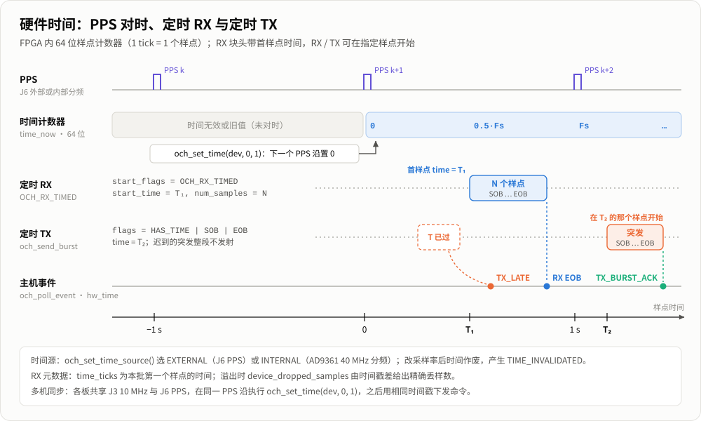

# 硬件时间戳与定时收发（OCH 0.6.0）

需要 FPGA CH32H417_IP 1.3 和配套 SDK（`SDK_CMD_1.1`）。0.6.0 起成帧是唯一的 USB 传输格式：每个 16 KiB 块带 16 字节头和样点时间，不再有 16 KiB 递增起始头；`och_config.usb_framing` 被忽略。打开设备时若 `system_info?` 不含 `transport=framed16k`，`och_open` 返回 `OCH_UNSUPPORTED`。

时间单位是样点（tick）：1 tick = 1/采样率。修改采样率后时间作废，需要重新设置，同时会产生 `OCH_EVENT_TIME_INVALIDATED` 事件。



块头格式见 [设备协议：成帧块格式](protocol.md#成帧块格式)，溢出与 epoch 的关系见 [架构：RX 成帧与间断](architecture.md#rx-成帧与间断)。

## 时间基准

```c
och_set_time_source(dev, OCH_TIME_SOURCE_EXTERNAL);  // 或 INTERNAL（AD9361 40 MHz 分频）
och_set_time(dev, 0, 1);                             // 下一个 PPS 沿把时间置 0
och_time_status t = {sizeof t}; och_get_time(dev, &t); // now / last_pps / pps_count / valid
```

多台设备同步：共享 J3 的 10 MHz 和 J6 的 PPS，各台都执行 `och_set_time(dev, 0, 1)`。

## RX

成帧模式下，`och_metadata` 会带上：

| 字段/标志 | 含义 |
|---|---|
| `OCH_META_HAS_TIME` | 时间戳有效 |
| `time_ticks` | 本次返回的第一个样点的时间 |
| `tick_rate` | 时间单位对应的采样率 |
| `device_dropped_samples` | FPGA 溢出丢样数，由时间戳之差得到，是精确值 |
| `OCH_META_END_OF_BURST` | 定时命令的最后一批样点 |
| `OCH_META_LATE` | 命令到达时请求的时间已过 |

定时接收的设置方法：

```c
och_stream_args a; och_default_stream_args(&a, OCH_RX);
a.start_flags = OCH_RX_TIMED; a.num_samples = 100000;      // 0 = 连续接收
a.start_time_lo = (uint32_t)T; a.start_time_hi = (uint32_t)(T >> 32);
// och_start 之后，第一个样点的 time_ticks == T
och_rx_command(rx, 0, T2, 5000);       // 后续命令；也可用 OCH_RX_NOW 或 OCH_RX_STOP
```

## TX

```c
och_tx_metadata md = {sizeof md, OCH_TX_HAS_TIME | OCH_TX_START_OF_BURST | OCH_TX_END_OF_BURST, T};
och_send_burst(tx, samples, n, &md, &accepted, 1000);  // 在样点时间 T 开始发射
```

- `END_OF_BURST` 的块会立即提交到 USB。
- 迟到的突发不会发射，并产生 `OCH_EVENT_TX_LATE` 事件。
- 每个突发结束产生 `OCH_EVENT_TX_BURST_ACK` 事件。
- 突发中途数据断流产生 `OCH_EVENT_TX_UNDERFLOW` 事件。
- `och_event.hw_time` 是事件发生时的样点时间。
- 过载时（例如 RX+TX 超过 UHSIF 约 533 MB/s）欠流和 RX GAP 可能每块都发生。v2026.11.07 之后的固件对 `tx_underflow`、`rx_overflow_gap` 做合并：每串的第一条单独上报，之后每 250 ms 最多一条汇总，停止某个方向时立即补报剩余部分。汇总记录的 `och_event.count`（0.6.1 起）为它代表的事件数，`hw_time`/`block` 是其中最后一条；普通事件 `count` 为 1。`device_underflows` 按 `count` 累加。
- 不带元数据的 `och_send` 仍可使用：发出的是不定时的连续流，第一块自动标记 SOB。

## SoapySDR

SoapySDR 插件把上面的能力对应到 Soapy 接口：`getHardwareTime` / `setHardwareTime`（`"pps"` 表示在下一个 PPS 生效）；`activateStream` 带 `HAS_TIME` 为定时接收，带 `numElems` 为有限长度接收；`writeStream` 带 `HAS_TIME` 为定时突发，带 `END_BURST` 结束突发；`readStreamStatus` 返回突发完成、迟到（`TIME_ERROR`）和欠流（`UNDERFLOW`）。时间以纳秒表示，按当前采样率与样点时间互换，所以改采样率后要重新设置硬件时间。gr-soapy 的 source 会输出 `rx_time` 标签，但 sink 不支持定时发射。详见 [SoapySDR 插件](soapy.md)。

## 兼容性

- 不能再连接旧固件（无成帧的 PL/SDK）；旧固件请使用 OCH 0.5.x。
- `och_metadata`、`och_event` 在末尾追加了字段，旧的 `struct_size` 仍可使用。
- `och_config` 和 `och_stream_args` 的新字段占用的是原来的 reserved 位置，结构体大小不变。
- `transfer_bytes` 只需是 16384 的倍数（原来是 49152）。

## 测试

```bash
g++ -std=c++17 -I src tests/frame_parser_test.cpp src/protocol/frame.cpp && ./a.out
g++ -std=c++17 -I include tests/hw_timestamp_test.cpp -L<build> -lomnicore -o hw_timestamp_test
```

`hw_timestamp_test` 需要连接设备。它使用 AD9361 数据口回环（`bist_loopback=1`），不需要射频线缆，依次检查：

1. 时间基准：立即设置与计数速率；
2. 内部 PPS：间隔等于采样率，下一个 PPS 沿装载；
3. 成帧 RX：2 秒内时间戳连续；
4. 定时 RX：首样点时间等于请求时间，样点数准确并带 EOB；
5. 定时 TX：经数据口回环，突发长度完整、TX→RX 延迟逐突发恒定，迟到突发不发射并上报事件；
6. 默认配置即为成帧传输并带硬件时间。

```bash
hw_timestamp_test [采样率]     # 例如 hw_timestamp_test 61440000；默认 30.72 MS/s
```

FPGA 版本须为 `0x01030001`，否则第 1 项失败。
