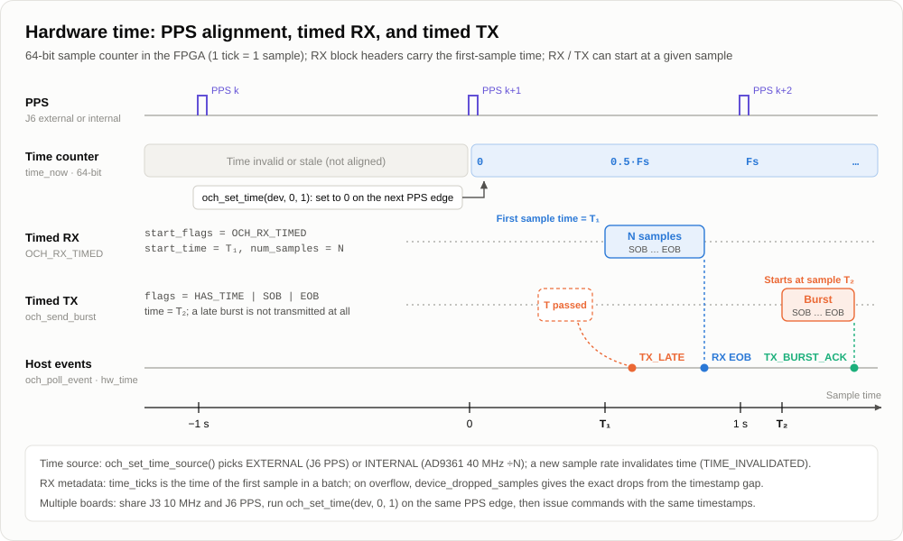

# Hardware Timestamps and Timed RX/TX

Requires FPGA CH32H417_IP 1.3 and a matching SDK (`SDK_CMD_1.1` or later). Since 0.6.0, framing is the only USB transport format: every 16 KiB block carries a 16-byte header and a sample time, and there is no longer a 16 KiB incrementing start header; `och_config.usb_framing` is ignored. If `system_info?` does not contain `transport=framed16k` when the device is opened, `och_open` returns `OCH_UNSUPPORTED`.

The unit of time is the sample (tick): 1 tick = 1/sample rate. Changing the sample rate invalidates the time, which then needs to be set again, and produces an `OCH_EVENT_TIME_INVALIDATED` event.



For the block header format see [Device Protocol: Framed block format](protocol.md#framed-block-format); for how overflows relate to epochs see [Architecture: RX framing and discontinuities](architecture.md#rx-framing-and-discontinuities).

## Time base

```c
och_set_time_source(dev, OCH_TIME_SOURCE_EXTERNAL);  // or INTERNAL (divided from the AD9361 40 MHz)
och_set_time(dev, 0, 1);                             // set time to 0 on the next PPS edge
och_time_status t = {sizeof t}; och_get_time(dev, &t); // now / last_pps / pps_count / valid
```

Aligning time across several devices: use `och sync` / `och_multi_sync()`, which takes care of the reference source, lock checks, and AD9361 MCS, and loads the time on the same edge; see [Multi-Board Sync](multi-board-sync.md). If you only need rough alignment, you can also share 10 MHz on J3 and PPS on J6 and run `och_set_time(dev, 0, 1)` on each device.

## RX

In framed mode, `och_metadata` carries:

| Field/flag | Meaning |
|---|---|
| `OCH_META_HAS_TIME` | Timestamp is valid |
| `time_ticks` | Time of the first sample returned by this call |
| `tick_rate` | Sample rate corresponding to the time unit |
| `device_dropped_samples` | Samples dropped by FPGA overflow, derived from the timestamp difference; an exact value |
| `OCH_META_END_OF_BURST` | Last batch of samples for a timed command |
| `OCH_META_LATE` | The requested time had already passed when the command arrived |

Setting up timed receive:

```c
och_stream_args a; och_default_stream_args(&a, OCH_RX);
a.start_flags = OCH_RX_TIMED; a.num_samples = 100000;      // 0 = continuous receive
a.start_time_lo = (uint32_t)T; a.start_time_hi = (uint32_t)(T >> 32);
// after och_start, time_ticks of the first sample == T
och_rx_command(rx, 0, T2, 5000);       // later commands; OCH_RX_NOW or OCH_RX_STOP also work
```

## TX

```c
och_tx_metadata md = {sizeof md, OCH_TX_HAS_TIME | OCH_TX_START_OF_BURST | OCH_TX_END_OF_BURST, T};
och_send_burst(tx, samples, n, &md, &accepted, 1000);  // start transmitting at sample time T
```

- A block with `END_OF_BURST` is submitted to USB immediately.
- A late burst is not transmitted and produces an `OCH_EVENT_TX_LATE` event.
- The end of each burst produces an `OCH_EVENT_TX_BURST_ACK` event.
- Data running out in the middle of a burst produces an `OCH_EVENT_TX_UNDERFLOW` event.
- `och_event.hw_time` is the sample time at which the event occurred.
- Under overload (e.g. RX+TX exceeding the roughly 533 MB/s of UHSIF), underflows and RX GAPs may occur on every block. Firmware after v2026.11.07 merges `tx_underflow` and `rx_overflow_gap`: the first in each series is reported on its own, then at most one summary every 250 ms, and the remainder is reported immediately when a direction is stopped. In a summary record, `och_event.count` (since 0.6.1) is the number of events it stands for, and `hw_time`/`block` are those of the last one; ordinary events have `count` 1. `device_underflows` accumulates by `count`.
- `och_send` without metadata still works: it sends an untimed continuous stream, and the first block is automatically marked SOB.

## SoapySDR

The SoapySDR plugin maps these capabilities onto the Soapy interface: `getHardwareTime` / `setHardwareTime` (`"pps"` takes effect on the next PPS); `activateStream` with `HAS_TIME` is timed receive, and with `numElems` a finite-length receive; `writeStream` with `HAS_TIME` is a timed burst, and `END_BURST` ends a burst; `readStreamStatus` returns burst completion, late (`TIME_ERROR`), and underflow (`UNDERFLOW`). Time is expressed in nanoseconds and converted to/from sample time at the current sample rate, so after changing the sample rate you need to set the hardware time again. The gr-soapy source emits `rx_time` tags, but the sink does not support timed transmit. See [SoapySDR Plugin](soapy.md) for details.

## Compatibility

- Older firmware (PL/SDK without framing) can no longer be connected; use OCH 0.5.x with older firmware.
- `och_metadata` and `och_event` have fields appended at the end; old `struct_size` values still work.
- New fields in `och_config` and `och_stream_args` occupy former reserved slots, so the struct sizes are unchanged.
- `transfer_bytes` only needs to be a multiple of 16384 (previously 49152).

## Testing

```bash
ctest --test-dir <build>                 # offline tests, including the frame_parser framing parser
g++ -std=c++17 -I include tests/hw_timestamp_test.cpp -L<build> -lomnicore -o hw_timestamp_test
```

`hw_timestamp_test` needs a connected device. It uses the AD9361 data-port loopback (`bist_loopback=1`), needs no RF cables, and checks in order:

1. Time base: immediate setting and counting rate;
2. Internal PPS: interval equals the sample rate, loaded on the next PPS edge;
3. Framed RX: timestamps continuous over 2 seconds;
4. Timed RX: first-sample time equals the requested time, sample count is exact, with EOB;
5. Timed TX: through the data-port loopback, burst length is complete, the TX→RX delay is constant from burst to burst, and late bursts are not transmitted and are reported as events;
6. The default configuration is the framed transport with hardware time.

```bash
hw_timestamp_test [sample-rate]     # e.g. hw_timestamp_test 61440000; default 30.72 MS/s
```

The FPGA version must be `0x01030001`, otherwise check 1 fails.
