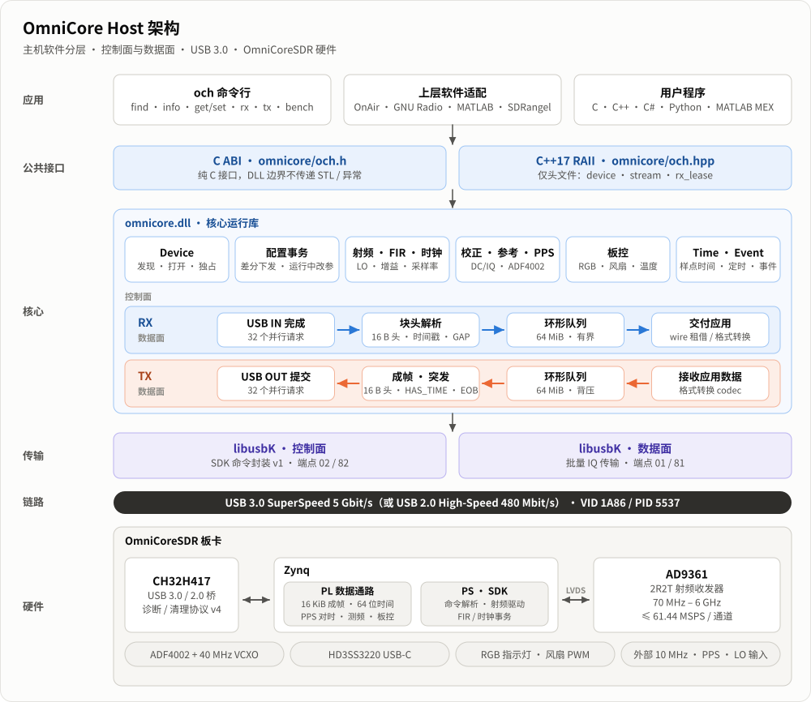

---
hide:
  - navigation
---

# OmniCore Host

OmniCore Host（OCH）是 **OmniCoreSDR**（AD9361 + Zynq + CH32H417 USB 桥）的主机端软件：C++17 运行库、命令行工具 `och`、公共 C/C++ SDK，以及 SoapySDR 插件和 MATLAB 工具箱。它负责设备发现、射频控制、连续 IQ 收发、硬件时间戳与吞吐测试。

| 版本 | 平台 | 接口 | 许可证 |
|---|---|---|---|
| **0.8.0**（C ABI 1） | Windows 10/11 x64 · Linux x86_64 · macOS 12+（通用二进制） | 纯 C ABI + 仅头文件 C++ RAII 包装 | GPL-3.0-or-later |

[下载发布包](https://github.com/Liren66/OmniCore-SDR-Host/releases){ .md-button .md-button--primary }
[安装](install.md){ .md-button }
[GitHub 源码](https://github.com/Liren66/OmniCore-SDR-Host){ .md-button }



!!! warning "固件要求"
    OCH 0.6.0 起需要 Zynq 固件 [v2026.11.07](https://github.com/Liren66/OmniCore-SDR-Firmware/releases/tag/v2026.11.07) 及以上（成帧 USB 传输），推荐 [v2026.11.08](https://github.com/Liren66/OmniCore-SDR-Firmware/releases/tag/v2026.11.08)。见 [固件兼容性](firmware-compatibility.md)。

## 从哪里开始

<div class="grid cards" markdown>

-   **安装与连接**

    ---

    在 Windows、Linux 或 macOS 上安装，再用 `och find`、`och info` 检查设备。

    [安装](install.md) · [命令行参考](cli.md) · [排错](troubleshooting.md)

-   **编程接入**

    ---

    使用 C ABI 或 C++ 包装：设备、数据流、运行中改参与元数据。

    [API 参考](api.md) · [架构](architecture.md)

-   **GNU Radio、SDR++、Python**

    ---

    SoapySDR 插件（`driver=omnicore`）可用于所有支持 SoapySDR 的软件。

    [SoapySDR 插件](soapy.md)

-   **MATLAB 与 Simulink**

    ---

    采集、发射、定时收发与全双工，不需要任何工具箱。

    [MATLAB 工具箱](matlab.md)

-   **硬件时间**

    ---

    64 位样点时间、PPS 对时、定时 RX、定时 TX 突发与多板同步。

    [硬件时间戳](timestamps.md) · [多板同步](multi-board-sync.md)

-   **性能**

    ---

    Windows 与 Linux 下 USB3 / USB2 实测吞吐及复现方法。

    [测试结果](benchmarks.md)

</div>

## 快速一览

```bash
och find                      # 枚举设备
och info                      # 身份、固件、USB 链路、RF 能力、电源
och rx --file rx.sc16 --channels 1,2 --lo-frequency 1G --sample-rate 15.36M --seconds 5
och bench --rx --tx --channels 1,2 --sample-rate 30.72M --seconds 10
```

```cpp
#include <omnicore/och.hpp>

och::device dev;                         // 唯一设备；多台时传序列号
auto cfg = och::default_config();
cfg.sample_rate = 30720000;
cfg.rx_mask = 3;                         // RX1 + RX2
dev.configure(cfg);

och::stream rx(dev, och::stream_args(OCH_RX));
rx.start();
```
